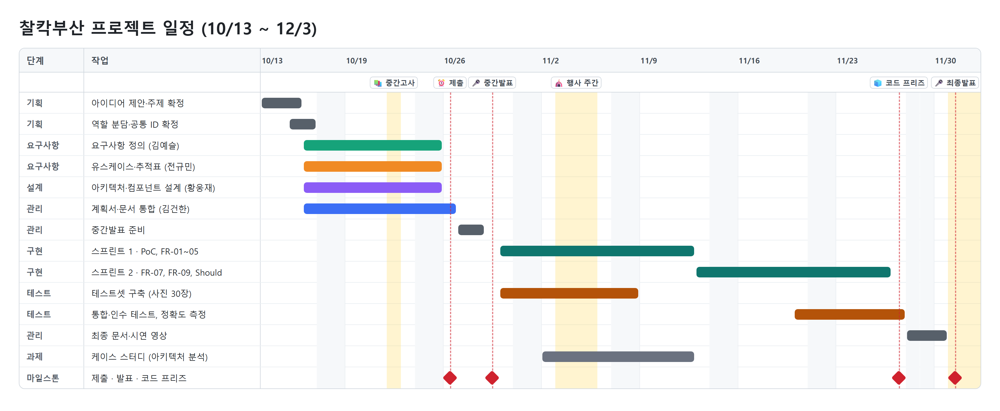

# 프로젝트 계획서 (SPP) — 찰칵부산(가칭)

- **팀**: 2026-2 소프트웨어공학 Team 10
- **담당**: 김건한 (PM·계획)
- **버전**: v1.0 · 2026-10-26 · 중간발표 제출본
- **관련 문서**: 요구사항분석서 v1.0, 설계서 v1.0

| 버전 | 날짜 | 작성 | 변경 내용 |
|---|---|---|---|
| v1.0 | 2026-10-26 | 김건한 | 중간발표 제출본 작성 (요구사항분석서·설계서 v1.0 통합 결과 반영) |

> 요구사항 ID(FR, NFR, AC 등)와 유스케이스 ID(UC)는 요구사항분석서 v1.0, 컴포넌트 ID(CP)는 설계서 v1.0을 그대로 참조한다.

---

## 1장. 프로젝트 개요

### 1.1 배경 및 목적

여행 중 찍은 사진은 하루 수십 장이지만 대부분 정리되지 않고, 여행기를 쓰려면 장소 검색·정보 확인·동선 정리·글쓰기를 모두 직접 해야 한다. 범용 AI에 사진을 보여 주면 장소를 추측하기 때문에 지역 장소를 틀리거나 출처를 대지 못한다.

이 프로젝트의 목적은 부산 여행 사진만 올리면 **방문 장소를 공식 관광 데이터 안에서 찾아 주고**, 확정된 장소로 **동선 지도와 출처가 붙은 여행기**를 만들어 주는 모바일 웹 서비스 "찰칵부산"을 개발하는 것이다.

### 1.2 서비스 개요

**처리 흐름**: 사진 업로드 → EXIF(촬영 시각·위치) 추출 → 방문지 군집화 → 공식 데이터 후보 조회 → VLM 장소 판별(애매하면 사용자 확인) → 동선 지도·타임라인 → 출처 각주가 붙은 여행기 → 공유 카드

- AI는 두 곳에서만 쓴다: (1) 후보 목록 안에서 사진과 맞는 장소 고르기(VLM), (2) 확정된 사실로 여행기 문장 쓰기(LLM).
- EXIF 처리, 군집화, 후보 검색, 확신도 라우팅, 이동 시간, 각주 연결, 사실 대조는 직접 구현한다.

### 1.3 과제 조건 충족 계획

| 과제 조건 | 충족 방법 | 근거 문서 |
|---|---|---|
| LLM 또는 VLM 활용 | VLM 장소 판별(FR-04), LLM 근거 기반 여행기(FR-09) | 요구사항분석서 8장 |
| 부산 실제 데이터·API 활용 | 한국관광공사 TourAPI, 부산광역시 명소·맛집 API, 카카오 로컬 | 요구사항분석서 7.1 |
| 핵심 기능 3개 이상 | 이미지 분석(사진 매칭), 데이터 검색(공식 후보 조회), 지도·위치 연동(동선), 근거 기반 여행기 생성 | 요구사항분석서 3장 |
| GitHub 기반 수행 | 이슈(백로그), PR 리뷰, 브랜치, 문서 버전 관리 | 본 문서 8장 |
| 개발 프로세스 수행 | 요구사항 분석 → 유스케이스 → 아키텍처·컴포넌트 설계 → 구현 → 테스트 | 본 문서 3장, 5장 |
| 데이터·정보 출처 명시 | 화면·여행기의 모든 사실에 출처·갱신일 표시(NFR-03) | 요구사항분석서 NFR-03, DR-08 |
| 저작권·이용조건 준수 | 공공누리 표기, 쿼터 준수, 테스트 사진은 팀원 직접 촬영 | 요구사항분석서 2.4, 7.1 |
| (제외) 단순 API 호출만으로 구성 | 파이프라인의 대부분(군집화, 후보 검색, 검증, 각주)을 직접 구현 | 설계서 1.3, 3장 |
| (제외) 타 과제와 동일 | 팀원 4명이 다른 과목·대회 과제와 주제가 겹치지 않음을 확인 (10/15) | — |

### 1.4 목표와 성공 기준

| 시점 | 목표 | 성공 기준 |
|---|---|---|
| 중간발표 (10/29) | 계획·요구사항·설계 기준선 확정 | 계획서, 요구사항분석서(유스케이스 포함), 설계서(3. 컴포넌트 설계까지) 제출 |
| 최종발표 (12/1·3) | MVP 시연과 테스트 결과 제시 | Must 기능(FR-01~05, 07, 09) 시연, 장소 매칭 정확도 80% 이상(NFR-02), 사진 20장 분석 1분 이내(NFR-01), 여행기 출처 표시 100%(NFR-03) |

---

## 2장. 개발 범위

### 2.1 포함 범위

| 우선순위 | 기능 | 요구사항 |
|---|---|---|
| Must (MVP 필수) | 사진 업로드·EXIF 추출, 방문지 군집화, 공식 데이터 후보 조회, VLM 판별·확신도, 사용자 확인·수정, 지도 동선·타임라인, 근거 기반 여행기 | FR-01~05, FR-07, FR-09 |
| Should (가능하면) | 위치 없는 사진 처리, 장소 상세, 공유 카드 | FR-06, FR-08, FR-11 |
| Could (여유 있으면) | 문단 다시 쓰기·사실 대조 경고, 근처 못 가본 곳 추천 | FR-10, FR-12 |

### 2.2 제외 범위

회원 가입·로그인(익명 기기 토큰으로 대체), 회원 간 소셜 기능, 결제(구독·포토북), 다국어 여행기, 부산 외 지역, 네이티브 앱

### 2.3 가정과 제약

- **가정**: 사용자 사진 대부분에 GPS가 있다. 부산 주요 관광지·음식점은 TourAPI 또는 카카오 로컬에 있다. 외부 API의 형식과 무료 쿼터가 개발 기간 동안 유지된다.
- **제약**: 실제 구현 기간 약 4주(10/30~11/27), 팀원 4명이 주당 약 10시간 투입, 무료 데이터와 무료 쿼터 사용, 원본 사진·좌표 비보관.

### 2.4 산출물

| 시점 | 산출물 | 위치 |
|---|---|---|
| 중간발표 | 계획서, 요구사항분석서(1~11장, 유스케이스·추적표 포함), 설계서(1~3장) | GitHub `docs/`, LMS 제출 |
| 최종발표 | 계획서(실적 반영), 최종 요구사항정의서, 최종 설계서(상세 설계 포함), 결과물(소스코드·시연 영상), 테스트 결과 | GitHub, LMS 제출 |

---

## 3장. 개발 프로세스

### 3.1 프로세스 모델

**스크럼 기반 반복 개발 + 초기 기술 PoC(프로토타입)** 를 사용한다.

| 프로젝트 특성 | 선택 | 근거 |
|---|---|---|
| 발표·제출 일정이 고정되어 있다 | 2주 단위 타임박스 스프린트, 범위는 MoSCoW로 조정 | 스크럼 |
| AI 매칭 정확도, 사진 GPS 보존 여부 등 기술 위험이 크다 | 스프린트 1 첫 주에 PoC로 먼저 검증 | 프로토타입 모델, 나선형 모델의 위험 분석 |
| 수업에서 단계별 산출물을 요구한다 | 중간발표 전까지 요구사항·설계 기준선 확정(v1.0) | 단계별 산출물 검토 |
| 요구사항과 테스트를 연결해야 한다 | 인수 기준(AC)·추적표 기반 테스트 | V 모델 |

### 3.2 스크럼 운영

| 항목 | 운영 방식 |
|---|---|
| 역할 | 프로덕트 오너·스크럼 마스터: 김건한(PM), 개발팀: 팀원 전원 |
| 제품 백로그 | GitHub Issues (요구사항 ID를 이슈 제목에 표기) |
| 스프린트 계획 | 스프린트 첫날, 백로그에서 이번 스프린트 항목 선택 |
| 일일 스크럼 | 메신저로 비동기 공유 (어제 한 일 / 오늘 할 일 / 막힌 점) |
| 스프린트 리뷰·회고 | 스프린트 마지막 날, 시연과 KPT 회고 |
| 완료 기준 (DoD) | 요구사항 ID와 연결된 이슈 종료, 단위 테스트 통과, PR 리뷰 1인 이상, 시연 시나리오에서 동작 확인 |

---

## 4장. 조직과 역할

### 4.1 팀 구성

| 이름 | 학번 | GitHub | 역할 |
|---|---|---|---|
| 김건한 | 2243219 | gokimkh123 | PM·계획 (팀 대표) |
| 김예슬 | 2443358 | seulseul44 | 요구사항 분석 |
| 전규민 | 2229930 | Seiun03 | 유스케이스 모델링 |
| 황웅재 | 2243416 | polopy07 | 아키텍처 설계 |

### 4.2 중간발표 역할 분담

중간발표 평가 항목 5개를 한 명이 하나씩 맡고, 발표도 맡은 파트를 직접 한다.

| 담당 | 평가 항목 | 산출물 | 주요 작업 | 발표 |
|---|---|---|---|---|
| 김건한 | 프로젝트 계획 및 개발범위, 발표 및 역할분담 | 계획서 | 범위·일정·WBS·위험 관리, 문서 통합·정합성 검토, LMS 제출 | 개요·계획 |
| 김예슬 | 요구사항 분석 | 요구사항분석서 1~4장, 6~9장 | 기능·비기능·UI·데이터·AI 요구사항, 인수 기준 | 요구사항 |
| 전규민 | 유스케이스 모델링 | 요구사항분석서 5장, 10장 | 액터·유스케이스 식별, 다이어그램, 명세, 요구사항 추적표 | 유스케이스 |
| 황웅재 | 아키텍처 설계 | 설계서 1~3장 | 아키텍처 스타일, 품질 속성, 컴포넌트 설계, 컴포넌트 다이어그램 | 아키텍처 |

문서 사이 정합성은 서로 검토했다: 설계 담당이 요구사항분석서 불일치 8건을 찾아 반영했고(이슈 #5), 유스케이스 담당이 추가로 3건을 찾아 v1.0에 반영했다(요구사항분석서 10.4).

### 4.3 구현 단계 역할 (안)

설계서 3.6의 컴포넌트 묶음을 기준으로 스프린트 1 계획 회의(10/30)에서 담당자를 확정한다.

| 역할 | 컴포넌트 | 인원 (안) |
|---|---|---|
| 프론트엔드 | CP-01 Web Client (화면 A1~D4, 카카오맵) | 1명 |
| 백엔드·데이터 | CP-02~06, CP-15~18 (API, 동선, 저장소, 외부 데이터 어댑터) | 1~2명 |
| AI 파이프라인 | CP-07~14, CP-19 (EXIF, 군집화, 후보 검색, VLM 매칭, 여행기, 사실 대조) | 1~2명 |
| PM·품질 | 일정·백로그 관리, 통합 테스트, 정확도 측정, 최종 문서 | 김건한 (구현 병행) |

### 4.4 의사소통

- 정기 회의: 수업일(화·목) 수업 후 짧게 진행 상황 공유
- 비동기: 팀 메신저(일일 공유), GitHub 이슈·PR 댓글(결정 사항과 근거 기록)
- 문서 사이 수정 요청은 GitHub 이슈로 남기고 담당자가 반영한다 (예: 이슈 #5)

---

## 5장. 일정 계획

### 5.1 마일스톤

| 날짜 | 마일스톤 | 상태 |
|---|---|---|
| 10/13(화) | 아이디어 제안 (GitHub 이슈 4건) | 완료 |
| 10/15(목) | 주제 확정(찰칵부산), 역할 분담 | 완료 |
| 10/17(토) | 요구사항분석서 초안 v0.1 | 완료 |
| 10/22(목) | 설계서 초안 v0.1, 중간고사 | 완료 |
| 10/25(일) | 문서 정합성 반영(v0.2), 유스케이스·추적표 | 완료 |
| **10/26(월)** | **중간발표 자료 LMS 제출 (밤 12시 마감)** | 본 제출 |
| **10/29(목)** | **중간발표 (10팀)** | 예정 |
| 10/30(금) | 스프린트 1 시작, 구현 역할 확정 | 예정 |
| 11/12(목) | 스프린트 1 리뷰, 케이스 스터디 발표(소프트웨어 아키텍처 분석) | 예정 |
| 11/26(목) | 스프린트 2 종료 | 예정 |
| **11/27(금)** | **코드 프리즈** | 예정 |
| **12/1(화) 또는 12/3(목)** | **최종발표** (마지막 번호 팀부터, 순서 공지 후 확정) | 예정 |

### 5.2 WBS

| WBS | 작업 | 산출물 | 담당 | 기간 |
|---|---|---|---|---|
| **1** | **프로젝트 관리** | | | |
| 1.1 | 주제 선정·역할 분담 | 이슈 #1~4, 역할표 | 전원 | 10/13~10/15 |
| 1.2 | 계획 수립 | 계획서 | 김건한 | 10/16~10/26 |
| 1.3 | 스프린트 운영·진척 관리 | 백로그, 회고 기록 | 김건한 | 10/30~11/27 |
| 1.4 | 발표 준비 (중간·최종) | 발표 자료 | 전원 | 10/27~10/28, 11/28~11/30 |
| **2** | **요구사항 분석** | | | |
| 2.1 | 요구사항 정의 (기능·비기능·UI·데이터·AI) | 요구사항분석서 1~4, 6~9장 | 김예슬 | 10/16~10/25 |
| 2.2 | 유스케이스 모델링 | 요구사항분석서 5장 | 전규민 | 10/16~10/25 |
| 2.3 | 요구사항 추적표·정합성 검토 | 요구사항분석서 10장 | 전규민, 김건한 | 10/24~10/26 |
| 2.4 | 요구사항 수집 (설문·인터뷰·사진 데이터 분석) | 요구사항분석서 v1.x | 김예슬 | 10/30~11/12 |
| **3** | **설계** | | | |
| 3.1 | 아키텍처·컴포넌트 설계 | 설계서 1~3장 | 황웅재 | 10/16~10/25 |
| 3.2 | 상세 설계 (클래스·DB 스키마·시퀀스·화면) | 최종 설계서 | 구현 담당 | 10/30~11/20 |
| **4** | **구현** | | | |
| 4.1 | 기술 PoC (VLM 모델, 군집화 임계값, 실기기 GPS 보존) | PoC 결과 | AI·프론트 | 10/30~11/5 |
| 4.2 | 사진 업로드·EXIF·군집화 (FR-01, 02) | CP-02, 07~09 | 백엔드·AI | 10/30~11/12 |
| 4.3 | 후보 조회·VLM 매칭·사용자 확인 (FR-03~05) | CP-03, 10, 11, 18, 19 | AI·백엔드 | 11/2~11/12 |
| 4.4 | 동선 지도·타임라인 (FR-07) | CP-01, 05 | 프론트 | 11/13~11/26 |
| 4.5 | 근거 기반 여행기 (FR-09) | CP-04, 13, 14 | AI | 11/13~11/26 |
| 4.6 | Should 기능 (FR-06, 08, 11) | CP-06, 12 | 여유 인원 | 11/16~11/26 |
| **5** | **테스트** | | | |
| 5.1 | 테스트셋 구축 (팀 촬영 사진 30장, 정답 라벨) | 테스트셋 | 전원 | 10/30~11/8 |
| 5.2 | 단위·통합 테스트 | 테스트 코드, CI | 구현 담당 | 10/30~11/26 |
| 5.3 | 시스템·인수 테스트, 정확도·성능 측정 | 테스트 결과서 | 김건한 외 | 11/20~11/27 |
| **6** | **최종 정리** | | | |
| 6.1 | 최종 문서·시연 영상 | 최종 산출물 | 전원 | 11/28~11/30 |

### 5.3 간트 차트

- **임계 경로**: 사진 업로드·군집화(4.2) → 후보 조회·VLM 매칭(4.3) → 근거 기반 여행기(4.5) → 시스템·인수 테스트(5.3) → 최종발표. 이 경로가 늦어지면 Should·Could 기능부터 뺀다.
- **일정 위험 구간**: 11/3~5 SW이노베이션 행사 주간(온라인 수업), 11/12 케이스 스터디 발표가 스프린트 1과 겹친다.

### 5.4 스프린트 계획

| 스프린트 | 기간 | 목표 | 포함 백로그 |
|---|---|---|---|
| 스프린트 1 | 10/30 ~ 11/12 | 사진에서 방문지와 장소를 확정하는 흐름 완성 | 기술 PoC, FR-01~05, 테스트셋 30장 라벨링 |
| 스프린트 2 | 11/13 ~ 11/26 | 동선과 여행기까지 전체 흐름 완성 | FR-07, FR-09, (여유 시) FR-06·08·11, 통합 테스트·정확도 측정 |
| 마무리 | 11/27 ~ 11/30 | 코드 프리즈, 테스트 결과서, 최종 문서 | 버그 수정만 허용 |

---

## 6장. 자원과 비용

| 자원 | 내용 | 비용 |
|---|---|---|
| 인력 | 4명 × 주 약 10시간 × 약 7주(10/13~11/30) | — |
| 개발 도구 | GitHub, VS Code, Docker Compose, Visual Paradigm(UML), pytest, GitHub Actions | 무료 |
| 공공데이터 | TourAPI 개발계정 일 1,000회, 부산광역시 명소·맛집 API 일 10,000회 | 무료 |
| 지도 | 카카오 지도·로컬 API (무료 쿼터 안에서 사용) | 무료 |
| AI 모델 | 멀티모달 LLM API (모델은 PoC 후 결정) | 유료 — 방문지당 대표 사진 1장·축소 전송, 장소 캐시로 호출 최소화, 팀 합의 월 상한 안에서 사용 |

규모와 노력은 WBS 작업 단위로 상향식 추정했고, 스프린트마다 실제 진척과 비교해 범위(Should·Could)를 조정한다.

---

## 7장. 위험 관리

절차: 위험 식별 → GitHub 이슈로 등록 → 가능성·영향 평가 → 대응 계획 → 스프린트 리뷰마다 점검

| ID | 위험 | 분류 | 가능성 | 영향 | 대응 계획 |
|---|---|---|---|---|---|
| R-01 | 모바일 웹 업로드나 메신저 전송 과정에서 사진 GPS가 지워진다 | 기술 | 중 | 상 | 스프린트 1 첫 주에 iOS Safari·Android Chrome 실기기로 확인. 위치 없는 사진 처리(FR-06), 업로드 전 원본 사진 안내, PC 업로드 대안 |
| R-02 | VLM 장소 매칭 정확도가 80%에 못 미친다 | 기술 | 중 | 상 | 후보 목록 안에서만 고르기(closed-set), 확신도 낮으면 사용자 확인, 매 스프린트 테스트셋 측정, AI Gateway로 모델 교체 |
| R-03 | LLM이 근거 없는 사실을 쓴다 (환각) | 기술 | 상 | 상 | 확정된 공식 데이터만 입력, 문장별 장소 ID, Fact Checker 전수 대조(AIR-05·06) |
| R-04 | 외부 API 쿼터 초과·장애 | 외부 의존 | 중 | 중 | 장소 캐시, 2회 재시도, 방문지 단위 부분 실패 허용(NFR-08) |
| R-05 | 구현 기간(4주) 부족 | 일정 | 상 | 상 | Must 범위 고정, Should·Could는 진척에 따라 조정, 코드 프리즈 11/27 |
| R-06 | 팀원 일정 충돌·연락 지연 | 인력 | 중 | 중 | 컴포넌트별 부 담당 지정, 수업일마다 진행 공유, 작업을 GitHub 이슈로 가시화 |
| R-07 | 사진 속 개인정보(얼굴·위치) 노출 | 법·윤리 | 하 | 상 | 원본·좌표 분석 후 삭제, EXIF 제거 썸네일만 보관, 인물 미분석(NFR-04) |
| R-08 | 데이터 저작권·이용조건 위반 | 법·윤리 | 하 | 중 | 공공누리 표기, 출처·갱신일 표시, 테스트 사진은 팀원 직접 촬영 |
| R-09 | AI API 비용 초과 | 비용 | 중 | 중 | 대표 사진 1장 축소 전송(AIR-07), 결과 캐시, 호출 수 기록 |
| R-10 | API 키 유출 | 보안 | 하 | 상 | 서버 환경변수로만 관리, 저장소에 `.env` 미포함, 카카오 JS 키 도메인 제한(NFR-07) |

---

## 8장. 품질 관리와 형상 관리

### 8.1 테스트 계획 (V 모델 대응)

| 테스트 단계 | 대응 산출물 | 대상과 방법 |
|---|---|---|
| 단위 테스트 | 설계서 3장 (컴포넌트) | 순수 로직 컴포넌트(CP-08 EXIF, CP-09 군집화, CP-11 확신도 라우팅, CP-14 사실 대조)를 pytest로 검증 |
| 통합 테스트 | 설계서 2장 (아키텍처) | 업로드 → 분석 파이프라인 → 결과 API 흐름. 외부 API·AI는 가짜·녹화 응답으로 대체 |
| 시스템 테스트 | 요구사항분석서 4장 (NFR) | 성능(NFR-01), 장애 주입(NFR-08), 개인정보 삭제 확인(AC-09) |
| 인수 테스트 | 요구사항분석서 9장 (AC) | 인수 기준 AC-01~16, 팀 외 5명 사용성 테스트(AC-11) |
| AI 평가 | 요구사항분석서 8장 | 팀 촬영 사진 30장 정답 라벨과 매칭 결과 비교(정확도 80%), 여행기 출처 표시율 100% |

### 8.2 형상 관리와 협업 규칙

- **저장소**: GitHub `gokimkh123/SWEngineering-project-10`. 기본 브랜치 `main`, 문서 작업 브랜치 `docs`, 개인 작업은 기능 브랜치 후 PR
- **리뷰**: PR은 팀원 1명 이상 리뷰 후 병합
- **문서 버전**: v0.x 초안 → v1.0 중간발표 기준선 → 최종발표 전 v2.0. 문서 첫머리에 변경 이력을 남긴다
- **ID 규칙**: 요구사항(FR·NFR 등)·유스케이스(UC)·컴포넌트(CP) ID는 지우거나 번호를 바꾸지 않고 새로 추가만 한다
- **AI 활용 기록**: AI 도움을 받은 범위를 문서 끝과 README에 날짜별로 기록한다

---

## 9장. 타당성 검토

| 관점 | 판단 | 근거 |
|---|---|---|
| 기술 | 가능 (위험 관리 필요) | 사용 기술이 모두 공개 라이브러리·API. 기술 위험(GPS 보존, 매칭 정확도)은 스프린트 1 PoC에서 먼저 확인 |
| 경제 | 가능 | 데이터·도구 무료, AI 호출 비용은 대표 사진 1장·캐시로 최소화 |
| 일정 | 가능 (범위 조정 전제) | Must 7개 기능 중심, Should·Could는 진척에 따라 조정 |
| 운영 | 가능 | 앱 설치 없는 모바일 웹, 회원 가입 없이 사용 |
| 법·이용조건 | 가능 | 공공누리 표기, 원본 사진·좌표 비보관, 인물 미분석, 팀 촬영 사진만 테스트에 사용 |

---

*AI 활용 명기: 이 계획서는 Claude Code(Anthropic)의 도움을 받아 작성함 — 팀 문서(요구사항분석서·설계서·유스케이스)와 GitHub 기록을 바탕으로 한 초안 작성, 간트 차트 작성. 팀 검토 후 확정한다.*
