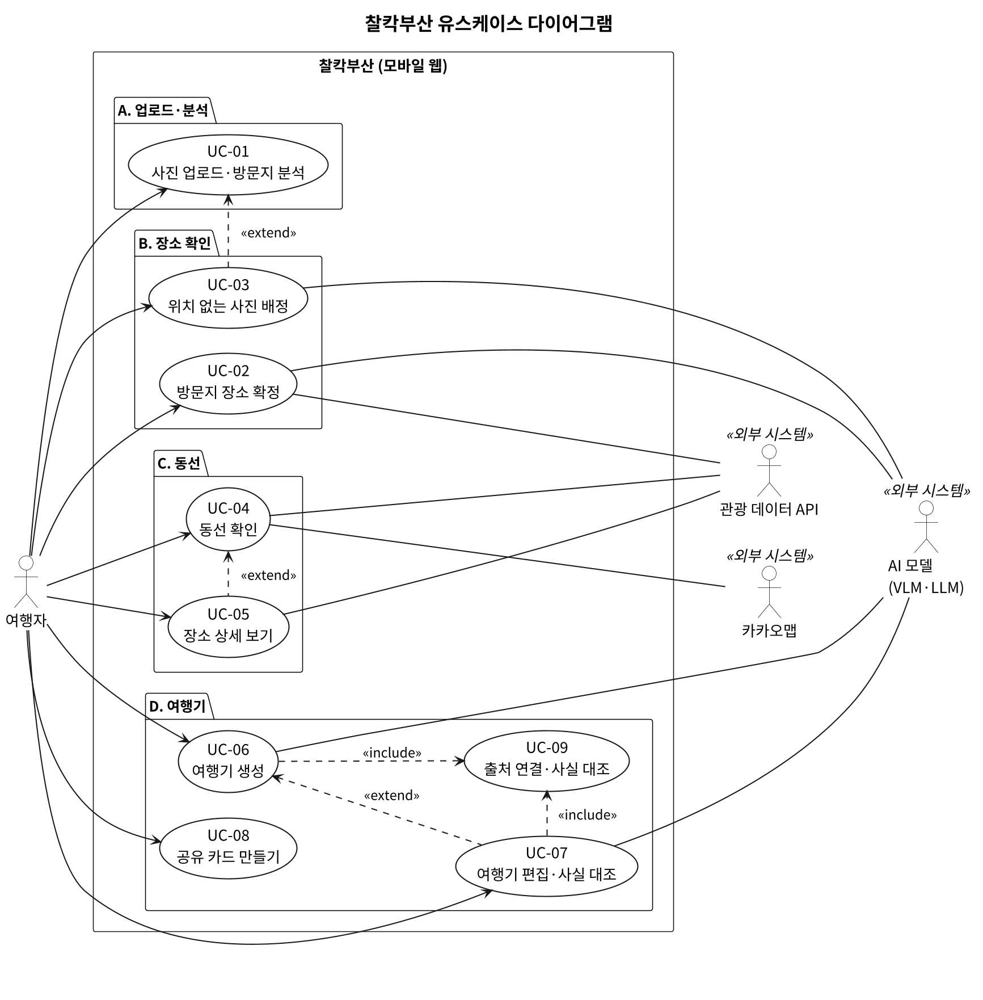
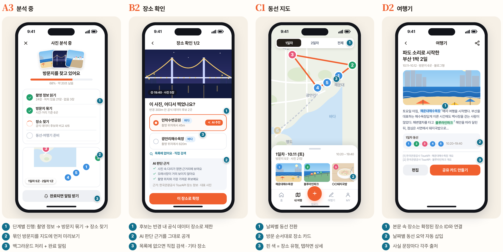

# 소프트웨어 요구사항 명세서 (SRS) — 찰칵부산(가칭)

- **팀**: 2026-2 소프트웨어공학 Team 10
- **작성**: 김예슬 (1~4장, 6~9장), 전규민 (5장, 10장), 통합 김건한
- **버전**: v1.0 · 2026-10-26 · 중간발표 제출본 (수업 SRS 템플릿 목차 그대로)
- **이전 작업본**: [v0.3 템플릿 양식본 docx](01_요구사항명세서SRS_찰칵부산_v0.3.docx), [유스케이스·추적표 상세본](../03-usecase/유스케이스_찰칵부산_v1.0.md)

| 버전 | 날짜 | 작성 | 변경 내용 |
|---|---|---|---|
| 0.1 | 2026-10-17 | 김예슬 | 초안 작성 (1~4장, 6~9장, 요구사항 ID 체계) |
| 0.2 | 2026-10-25 | 김건한 | 이슈 #5(설계서와의 불일치 8건) 반영 |
| 0.3 | 2026-10-25 | 김예슬 | SRS 템플릿 양식으로 이관, 요구사항 수집 계획 정리 |
| 1.0 | 2026-10-26 | 김건한 | 중간발표 제출본: 템플릿 목차에 맞춰 10쪽 이내로 정리, 5장·10장 통합(작성: 전규민), AC-13~17 추가, FR-08 Must·FR-12 Should, 정확도 정의, AI 모델 방침, 카카오 운영정책, AI 분석 동의·여행 삭제 |

---

## 1. 문서 개요 (Introduction)

### 1.1 목적 (Purpose)

- "찰칵부산"의 기능·품질 요구사항 정의. 설계·구현·테스트와 평가의 기준 문서
- 요구사항 도출: 경쟁 서비스 분석·브레인스토밍(이슈 #1~#4)·화면 시안. 설문·인터뷰 결과는 최종 요구사항정의서(v2.0)에 반영

### 1.2 프로젝트 범위 (Scope)

- 사진을 "여기가 어디?"라는 이미지 질의로 받아 부산 공식 데이터로 장소를 찾는 부산 지역 안내 모바일 웹 서비스
- 장소 정보·근처 명소·동선 지도와 출처 각주가 붙은 여행기 제공

| 구분 | 포함 기능 |
|---|---|
| MVP 필수 (Must) | 사진 업로드·EXIF 분석, 방문지 묶기, 장소 매칭, 사용자 확인, 동선 지도, 장소 상세(출처), 여행기 생성 |
| 권장 (Should) | 위치 없는 사진 처리, 공유 카드, 근처 못 가본 곳 추천 |
| 선택 (Could) | 문단 다시 쓰기·사실 대조 경고 |
| 범위 밖 | 회원 가입·로그인(익명 기기 토큰으로 대체), 소셜 기능, 결제, 다국어 여행기, 부산 외 지역, 네이티브 앱 |

### 1.3 용어 및 약어 (Definitions & Acronyms)

| 용어/약어 | 정의 |
|---|---|
| LLM / VLM | 대규모 언어 모델 / 이미지와 텍스트를 함께 이해하는 모델 |
| EXIF | 사진 파일에 저장된 촬영 시각·GPS 좌표 등 촬영 정보 |
| 방문지 (Visit) | 시간·거리가 가까운 사진을 DBSCAN으로 묶은 단위. 실제 장소 하나에 대응 |
| closed-set 매칭 | AI가 공식 데이터로 찾은 후보 목록 안에서만 장소를 고르는 방식 |
| 확신도 | VLM이 고른 장소가 맞을 가능성(0~1) |
| 평가셋 | 정확도 측정용 팀 촬영 사진과 정답 라벨(방문지 20곳 이상). 임계값 조정용 사진과 분리 |
| 익명 기기 토큰 | 회원 가입 없이 기기마다 발급해 "내 여행"을 구분하는 값 |

## 2. 전체 설명 (Overall Description)

### 2.1 제품 관점 (Product Perspective)

- 공공데이터·지도·AI API와 연동하는 독립형 모바일 웹 서비스
- 처리 흐름: 사진 업로드 → EXIF 추출 → 방문지 군집화 → 후보 조회 → VLM 판별(애매하면 사용자 확인) → 동선·장소 상세 → 각주가 붙은 여행기 → 공유 카드

### 2.2 대상 사용자 (Target Users)

| 사용자 유형 | 특징 | 주요 목표 | 권한/제약 |
|---|---|---|---|
| 국내 여행자 (주 사용자) | 20~30대, 부산 1~3일 여행. 페르소나 지민(23세, 1박 2일 사진 200장 중 블로그에 3장 올리고 멈춤) | 사진만 올려 장소·동선을 정리하고 여행기 남기기 | 익명 기기 토큰으로 자기 여행만 조회·수정·삭제 |
| 외국인 관광객 | 한글 지명 검색이 어려움 | 다국어 여행기 | 2단계 (MVP 범위 밖) |

### 2.3 운영 환경 (Operating Environment)

- Client: 모바일 웹 브라우저(iOS Safari, Android Chrome 최신 버전), 데스크톱 브라우저
- Server: Docker Compose — FastAPI 서버, Python 분석 워커, 오픈소스 VLM 추론 서버
- External AI/API: LLM API(Claude Haiku 또는 Gemini 무료 플랜), TourAPI, 부산광역시 명소·맛집 API, 카카오 지도·로컬
- Database: PostgreSQL (장소 캐시 포함)

### 2.4 제약사항 (Constraints)

- 과제 조건: LLM·VLM과 부산 공공데이터·API 활용, 군집화·후보 검색·라우팅·각주 연결은 자체 코드로 구현
- 이용조건: 출처·공공누리 표시, 카카오 로컬 결과는 운영정책상 장소 ID·URL만 저장
- 개인정보: AI 분석 전 동의, 사진은 서버의 VLM으로만 분석(외부 AI 미전송), 원본·좌표는 분석 후 삭제, 인물 미분석
- 비용·한도: 공공데이터 쿼터(TourAPI 일 1,000회 등) 안에서 동작, AI는 오픈소스 VLM과 저가·무료 LLM 사용
- 범위·일정: 테스트 사진은 팀 촬영본만 사용, 결제·예약은 범위 밖. 중간발표 10/29, 코드 프리즈 11/27, 최종발표 12/1·3

### 2.5 가정 및 의존성 (Assumptions & Dependencies)

- 사진 대부분에 GPS가 있다고 가정(없으면 FR-06·FR-02로 대응). 모바일 웹 업로드의 GPS 유지 여부는 스프린트 1 실기기 PoC로 확인
- 주요 관광지·음식점은 TourAPI·부산시 데이터·카카오 로컬에 등록되어 있고, 외부 API의 형식·무료 쿼터가 개발 기간 동안 유지된다고 가정
- VLM 모델, 군집화·확신도 임계값은 기술 PoC 후 확정

## 3. 기능 요구사항 (Functional Requirements)

| ID | 요구사항명 | 요구사항 내용 | 우선순위 | 검증 방법 | 비고 |
|---|---|---|---|---|---|
| FR-01 | 사진 업로드·EXIF 추출 | 사진 1~30장(JPEG·HEIC·PNG, 장당 20MB 이하) 업로드가 가능해야 함. 촬영 시각·GPS를 추출해 "위치 있음 N장 · 없음 M장"으로 표시해야 함. 30장 초과는 차단, 미지원 형식·20MB 초과 사진은 제외 후 안내 | Must | Test | UC-01 · AC-01 |
| FR-02 | 방문지 자동 군집화 | 촬영 시각·좌표에 DBSCAN을 적용해 사진을 방문지로 묶고, 방문 순서·사진 수·중심 좌표·시간대를 날짜별로 계산해야 함. 위치 있는 사진이 없으면 촬영 시각으로 묶고 전부 선택필요로 지정 | Must | Test | UC-01 · AC-02 |
| FR-03 | 공식 데이터 후보 조회 | 방문지 반경 300m(없으면 600m) 안의 장소를 TourAPI, 부산광역시 명소·맛집 데이터, 카카오 로컬(음식점·카페 보조)에서 찾아 후보 2~3곳을 제시해야 함. 후보가 없으면 사용자 선택으로 전환. 공공데이터 결과는 캐시, 카카오 결과는 장소 ID·URL만 저장 | Must | Test | UC-02 · AC-03 |
| FR-04 | VLM 후보 판별·확신도 산출 | 대표 사진 1장과 후보 목록을 VLM에 보내 장소 ID·확신도(0~1)·근거를 받아야 함. 확신도 0.8 이상 자동 확정, 0.5 이상 0.8 미만 사용자 확인, 0.5 미만 사용자 선택(8장) | Must | Test / AI 평가 | UC-02 · AC-04 |
| FR-05 | 사용자 확인·수정 | 확인이 필요한 방문지에서 사진·후보·AI 추천과 근거를 보고 장소 선택, 직접 검색, "기타 장소"(방문지 중심 좌표) 저장이 가능해야 함. 자동 확정 결과도 수정 가능, 결과는 매칭 로그(DR-09)로 기록 | Must | Test | UC-02 · AC-05 |
| FR-06 | 위치 없는 사진 처리 | GPS 없는 사진의 촬영 시각이 앞뒤 방문지 사이면 해당 방문지를, 애매하면 VLM으로 인접 사진과 비교해 추천해야 함. 배정은 사용자가 확인 | Should | Test | UC-03 · AC-13 |
| FR-07 | 지도 동선·타임라인 | 확정된 방문지를 카카오맵에 방문 순서대로 핀·경로로 표시하고, 이동 시간을 타임라인으로 표시해야 함. 날짜별·전체 보기 전환 가능 | Must | Test | UC-04 · AC-06 |
| FR-08 | 장소 상세 | 방문지 선택 시 공식 데이터의 개요·주소·대표 사진·출처·갱신일을 표시해야 함. 카카오 장소는 이름·주소를 실시간 조회하고 카카오 장소 페이지로 연결 | Must | Test | UC-05 · AC-14 |
| FR-09 | 근거 기반 여행기 생성 | 확정 방문지·공식 정보·선택한 문체로 LLM 여행기(제목, 본문, 날짜별 동선 요약)를 생성해야 함. 장소 이름은 장소 ID와 연결, 사실 문장마다 출처 각주와 AI 작성 표시 | Must | Test / AI 평가 | UC-06, UC-09 · AC-07 |
| FR-10 | 문단 다시 쓰기·사실 대조 경고 | 여행기 문단 단위 재생성이 가능해야 함. 편집한 문장이 공식 데이터와 다르면(운영시간, 위치 등) 경고 | Could | Test | UC-07, UC-09 |
| FR-11 | 공유 카드 생성 | 대표 사진·제목·동선 요약으로 공유 이미지를 생성해야 함. 좌표·정확한 위치 정보는 제외 | Should | Test | UC-08 · AC-10 |
| FR-12 | 근처 못 가본 곳 추천 | 방문지 주변 공식 데이터 장소 중 미방문 장소 2~3곳을 거리순으로 이름·유형·거리·출처와 함께 안내해야 함 | Should | Test | UC-04 · AC-17 |

## 4. 비기능 요구사항 (Non-functional Requirements)

| ID | 요구사항명 | 요구사항 내용 | 우선순위 | 검증 방법 | 비고 |
|---|---|---|---|---|---|
| NFR-01 | 성능 (응답시간) | 사진 20장 분석(업로드 완료~방문지 확인 화면)이 1분 이내에 완료되어야 함 | Must | Test — 20장 세트 10회 평균 | AC-08 |
| NFR-02 | 정확도 | 방문지 단위 장소 매칭 정확도(AI 1순위가 정답인 방문지 ÷ 평가셋 전체 방문지) 80% 이상, 정답이 후보에 포함되는 비율(후보 포함률) 90% 이상이어야 함 | Must | AI 평가 — 평가셋(방문지 20곳 이상) | AC-04 |
| NFR-03 | 신뢰성 (출처) | 여행기 사실 문장(위치·운영시간·요금·역사·특징 등 공식 데이터로 확인 가능한 문장)의 100%에 출처가 표시되어야 함 | Must | Review — 전수 검사 | AC-07 |
| NFR-04 | 개인정보 보호 | AI 분석 전 동의를 받고, 사진은 서버의 VLM으로만 분석해야 함(외부 AI 미전송). 원본 사진·좌표는 분석 후 삭제, EXIF를 제거한 썸네일만 보관, 인물 미분석, 여행 삭제 시 관련 데이터 전부 삭제 | Must | Test / Review — 동의·호출 기록·저장소 확인 | AC-09 |
| NFR-05 | 사용성 | 확인이 필요한 방문지만 질문하고, 처음 쓰는 사용자가 업로드부터 여행기까지 5분 안에 완료할 수 있어야 함 | Must | Test — 팀 외 5명 | AC-11 |
| NFR-06 | 호환성 (이식성) | 앱 설치 없이 iOS Safari·Android Chrome 모바일 웹에서 동작해야 함 | Must | Test — 실기기 | AC-12 |
| NFR-07 | 보안 | API 키는 서버에만 두고 클라이언트·GitHub에 노출하지 않아야 함. 카카오맵 JavaScript 키는 예외로 하되 도메인 제한으로 보호 | Must | Review — 비밀값·도메인 제한 | AC-15 |
| NFR-08 | 비용·가용성 (오류 복구) | 공공데이터·지도·LLM API는 무료 쿼터나 저가 요금 안에서 동작해야 함. 외부 API 실패 시 오류 안내 및 재시도 가능 | Should | Test — 캐시 적중률, 장애 주입 | AC-16 |

## 5. 유스케이스 (Use Cases)

### 5.1 Use Case Diagram

- 주 Actor: 여행자 / 보조 Actor: 관광 데이터 API(TourAPI·부산시·카카오 로컬), AI 모델(VLM·LLM), 카카오맵
- 유스케이스 9개를 화면 단계(A 업로드·분석 → B 장소 확인 → C 동선 → D 여행기) 순으로 배치 (원본: docs/03-usecase/usecase-diagram.puml)

### 5.2 Use Case 명세

| Use Case ID | UC-01 |
|---|---|
| 이름 | 사진 업로드·방문지 분석 |
| Actor | 여행자 |
| 사전조건 | 부산 여행 사진이 갤러리에 있고, 사진의 AI 분석에 동의함 (NFR-04) |
| 트리거 | 여행자가 홈에서 "새 여행기" 선택 |
| 기본 흐름 | 1. 여행자가 사진 1~30장(JPEG·HEIC·PNG, 장당 20MB 이하) 선택, 시스템이 검사 후 업로드 2. 시스템이 촬영 시각·GPS를 추출해 "위치 있음 N장 · 없음 M장" 표시 3. 시스템이 사진을 방문지로 묶어 날짜별로 나누고, 진행률과 묶인 방문지를 먼저 표시 4. 묶기 완료 후 UC-02로 진행 |
| 대안/예외 흐름 | 1a. 31장 이상은 차단, 미지원 형식·20MB 초과 사진은 제외 후 안내. 2a. 시각·위치가 모두 없는 사진은 제외 여부 확인 3a. 위치 없는 사진이 있으면 UC-03 수행, 위치 있는 사진이 없으면 촬영 시각으로 묶음(UC-02에서 전부 선택필요) 3b. 화면을 떠나도 분석 계속, 재접속 시 진행 상태·결과 표시 |
| 사후조건 | 방문지 생성(상태: 분석중), 원본 사진은 분석 후 삭제 (DR-08) |
| 관련 요구사항 | FR-01, FR-02 · NFR-01, NFR-04 · UI-01~03 |
| 비고 | 화면 A1~A3. 확장점 "위치 없는 사진" → UC-03 |

| Use Case ID | UC-02 |
|---|---|
| 이름 | 방문지 장소 확정 |
| Actor | 여행자 (보조: 관광 데이터 API, AI 모델 VLM) |
| 사전조건 | UC-01에서 방문지 생성 완료 |
| 트리거 | 방문지 군집화 완료 (UC-01에서 이어짐) |
| 기본 흐름 | 1. 시스템이 방문지 반경 300m 안의 후보를 관광 데이터 API에서 조회(공공데이터는 장소 캐시) 2. 대표 사진과 후보를 VLM에 보내 장소·확신도·근거를 받고, 후보 안의 답인지 검사 3. 확신도로 상태 지정(0.8 이상 자동확정, 0.5 이상 0.8 미만 확인필요, 0.5 미만 선택필요), 확인필요·선택필요만 표시 4. 여행자가 후보를 고르면 확정 및 매칭 로그 기록, 모두 끝나면 확정 완료 화면 표시 |
| 대안/예외 흐름 | 1a. 후보가 없으면 600m로 확대, 그래도 없거나 외부 API가 2회 재시도 후에도 실패하면 해당 방문지만 선택필요 2a. VLM이 "없음"으로 답하거나 후보 밖 답·형식 오류가 재요청 후에도 이어지면 선택필요 4a. 맞는 후보가 없으면 직접 검색 또는 "기타 장소"로 저장. 4b. 자동확정된 방문지도 수정 가능 |
| 사후조건 | 모든 방문지가 자동확정·확정·기타장소 중 하나로 지정, 원본 사진·좌표 삭제 (DR-08) |
| 관련 요구사항 | FR-03, FR-04, FR-05 · NFR-02, NFR-05, NFR-08 · AIR-01~04 · DR-09 |
| 비고 | 화면 B1, B2, B4. VLM은 사진 속 인물 미분석 (AIR-04) |

| Use Case ID | UC-03 |
|---|---|
| 이름 | 위치 없는 사진 배정 |
| Actor | 여행자 (보조: AI 모델 VLM) |
| 사전조건 | GPS가 없는 사진이 있고, 다른 사진으로 방문지가 묶여 있음 |
| 트리거 | UC-01에서 위치 없는 사진 발견 (확장점 "위치 없는 사진") |
| 기본 흐름 | 1. 시스템이 촬영 시각으로 앞뒤 방문지를 찾아 추천, 사진별 추천 이유 표시 2. 여행자가 확인하면 해당 방문지에 배정 |
| 대안/예외 흐름 | 1a. 시각만으로 애매하면 VLM이 인접 방문지 사진과 비교해 추천. 2a. 다른 방문지 선택 또는 미배정 유지 가능 |
| 사후조건 | 확인한 사진이 방문지에 배정됨 |
| 관련 요구사항 | FR-06 |
| 비고 | 화면 B3. UC-01을 확장 «extend» |

| Use Case ID | UC-04 |
|---|---|
| 이름 | 동선 확인 |
| Actor | 여행자 (보조: 카카오맵, 관광 데이터 API) |
| 사전조건 | 방문지 장소 확정 완료 (UC-02) |
| 트리거 | 여행자가 동선 지도 선택 |
| 기본 흐름 | 1. 시스템이 카카오맵에 방문 순서대로 핀(유형별 색·순서 번호)과 경로를 그리고, 이동 시간을 타임라인으로 표시 2. 여행자가 1일차·2일차·전체 보기 전환 3. 핀이나 방문지 카드 선택 시 UC-05 수행 |
| 대안/예외 흐름 | 1a. 지도나 경로를 불러오지 못하면 안내 후 재시도 2a. "근처 못 가본 곳" 선택 시 주변 공식 데이터 장소 중 미방문 장소 2~3곳을 거리순으로 표시 (FR-12) |
| 사후조건 | — (조회 기능) |
| 관련 요구사항 | FR-07, FR-12 · UI-06 · NFR-08 |
| 비고 | 화면 C1, C2, C4. 확장점 "장소 선택" → UC-05 |

| Use Case ID | UC-05 |
|---|---|
| 이름 | 장소 상세 보기 |
| Actor | 여행자 (보조: 관광 데이터 API) |
| 사전조건 | 장소가 확정된 방문지가 있음 |
| 트리거 | UC-04에서 핀이나 방문지 카드 선택 (확장점 "장소 선택") |
| 기본 흐름 | 1. 시스템이 장소 개요, 주소, 대표 사진, 출처, 갱신일 표시 |
| 대안/예외 흐름 | 1a. "기타 장소"는 공식 정보 없음 안내. 1b. 카카오 장소는 이름·주소를 실시간 조회하고 카카오 장소 페이지로 연결 |
| 사후조건 | — (조회 기능) |
| 관련 요구사항 | FR-08 · UI-06, UI-07 · DR-03 |
| 비고 | 화면 C3. UC-04를 확장 «extend». 여행기 본문의 장소 이름으로도 진입 (UI-07) |

| Use Case ID | UC-06 |
|---|---|
| 이름 | 여행기 생성 |
| Actor | 여행자 (보조: AI 모델 LLM) |
| 사전조건 | 모든 방문지가 자동확정·확정·기타장소 중 하나임 |
| 트리거 | 여행자가 "여행기 만들기" 선택 |
| 기본 흐름 | 1. 여행자가 문체를 고르면 시스템이 확정 방문지와 공식 정보만 LLM에 넣어 여행기 생성(문장마다 근거 장소 ID) 2. UC-09로 각주 연결 및 사실 대조 3. 제목, 본문, 날짜별 동선 요약, 각주 목록과 AI 작성 표시 출력 |
| 대안/예외 흐름 | 1a. 생성 실패 시 안내 후 재시도. 2a. 근거 없는 사실 문장은 경고 또는 제거. 3a. 편집 선택 시 UC-07 수행 |
| 사후조건 | 여행기와 각주 저장 |
| 관련 요구사항 | FR-09 · NFR-03, NFR-08 · AIR-05, AIR-06 · UI-07 |
| 비고 | 화면 D1, D2. UC-09를 포함 «include», 확장점 "편집" → UC-07 |

| Use Case ID | UC-07 |
|---|---|
| 이름 | 여행기 편집·사실 대조 |
| Actor | 여행자 (보조: AI 모델 LLM) |
| 사전조건 | 생성된 여행기가 있음 (UC-06) |
| 트리거 | 여행자가 여행기에서 편집 선택 (확장점 "편집") |
| 기본 흐름 | 1. 여행자가 문단 다시 쓰기 요청(해당 문단만 LLM으로 재생성) 또는 문장 직접 편집 2. 시스템이 UC-09로 각주를 연결하고, 공식 데이터와 다른 사실(운영시간, 위치 등)에 경고 표시 3. 여행자가 수정하거나 그대로 저장 |
| 대안/예외 흐름 | 1a. 재생성 실패 시 기존 문단 유지 후 안내 |
| 사후조건 | 수정한 여행기 저장 |
| 관련 요구사항 | FR-10 · AIR-06 |
| 비고 | 화면 D3. UC-06을 확장 «extend», UC-09를 포함 «include». 우선순위 Could |

| Use Case ID | UC-08 |
|---|---|
| 이름 | 공유 카드 만들기 |
| Actor | 여행자 |
| 사전조건 | 생성된 여행기가 있음 (UC-06) |
| 트리거 | 여행자가 "공유 카드 만들기" 선택 |
| 기본 흐름 | 1. 시스템이 EXIF를 제거한 대표 썸네일, 제목, 동선 요약으로 공유 이미지 생성(좌표·정확한 위치 제외) 2. 여행자가 이미지를 저장하거나 공유 |
| 대안/예외 흐름 | 1a. 이미지 생성 실패 시 안내 후 재시도 |
| 사후조건 | 저장·공유 가능한 이미지 생성 |
| 관련 요구사항 | FR-11 · DR-04, DR-08 |
| 비고 | 화면 D4 |

| Use Case ID | UC-09 |
|---|---|
| 이름 | 출처 연결·사실 대조 |
| Actor | — (UC-06, UC-07이 포함해 실행) |
| 사전조건 | 생성·편집된 여행기 문장과 근거 방문지·장소 데이터가 있음 |
| 트리거 | UC-06 또는 UC-07의 문장 생성·편집 |
| 기본 흐름 | 1. 문장마다 표시된 근거 장소 ID가 확정 방문지의 장소인지 확인, 사실 문장에 출처명·갱신일 각주 부착 2. 문장의 데이터 필드 값(운영시간, 위치 등)을 공식 데이터와 대조(편집 문장은 장소명·시간·요금 같은 수치만) 3. 근거가 없거나 데이터와 다른 문장을 표시해 반환 |
| 대안/예외 흐름 | — |
| 사후조건 | 모든 사실 문장에 각주 부착 또는 경고 표시 |
| 관련 요구사항 | FR-09, FR-10 · NFR-03 · AIR-06 · DR-06 |
| 비고 | 화면 D2, D3. AI 없이 코드로 처리 |

## 6. UI / UX 요구사항

### 6.1 주요 화면 목록

| 화면 ID | 화면명 | 목적 | 관련 요구사항 |
|---|---|---|---|
| A1 | 홈 · 새 여행기 | 내 여행 목록, 새 여행기 시작, 여행 삭제 | NFR-04 |
| A2 | 사진 선택 | 사진 최대 30장 선택·업로드, AI 분석 동의 | FR-01, NFR-04 |
| A3 | 분석 중 | 진행률·방문지 미리보기, 다시 접속하면 상태·결과 표시 | FR-01, FR-02 |
| B1 | 방문지 목록 | 방문지별 매칭 결과와 상태 확인 | FR-02, FR-04 |
| B2 | 장소 확인 | 후보·AI 추천·판단 근거를 보고 장소 확정 | FR-05 |
| B3 | 위치 없는 사진 | 추천 방문지 확인·배정 | FR-06 |
| B4 | 확정 완료 | 모든 방문지 확정 결과 요약 | FR-05 |
| C1 | 동선 지도 | 방문 순서대로 핀·경로, 날짜별 전환 | FR-07 |
| C2 | 타임라인 | 방문지별 시간대와 이동 시간 | FR-07 |
| C3 | 장소 상세 | 공식 정보·출처·갱신일 | FR-08 |
| C4 | 근처 못 가본 곳 | 방문지 주변 미방문 장소 추천 | FR-12 |
| D1 | 문체 선택 | 여행기 문체(블로그형 등) 선택 | FR-09 |
| D2 | 여행기 | 각주가 붙은 여행기와 동선 요약 | FR-09 |
| D3 | 편집 · 사실 대조 | 문단 다시 쓰기, 편집 문장 사실 대조 경고 | FR-10 |
| D4 | 공유 카드 | 위치 정보 없는 공유 이미지 생성·저장 | FR-11 |

| ID | UI 요구사항 (하단 탭: 홈 · 업로드 · 내 여행 · 여행기 · MY) | 화면 | 관련 요구사항 |
|---|---|---|---|
| UI-01 | 단계별 진행률(촬영 정보 → 방문지 묶기 → 장소 찾기 → 여행기 준비)과 남은 시간 표시 | A3 | FR-01, FR-02 |
| UI-02 | 분석 중에도 이미 묶인 방문지를 지도에 먼저 표시 | A3 | FR-02 |
| UI-03 | 화면을 떠나도 서버에서 분석 계속, 재접속 시 진행 상태나 결과 표시 | A3 | NFR-05 |
| UI-04 | 후보마다 촬영 위치와의 거리, AI 추천, 판단 근거와 출처 표시 | B2 | FR-05 |
| UI-05 | 후보가 없어도 "직접 검색"과 "기타 장소" 항상 제공 | B2 | FR-05 |
| UI-06 | 지도 핀은 유형별 색과 방문 순서 번호로 구분, 선택 시 상세로 이동 | C1 | FR-07, FR-08 |
| UI-07 | 본문의 장소 이름은 장소 상세로, 각주 번호는 하단 출처 목록으로 연결 | D2 | FR-09 |
| UI-08 | 360px 폭에서 가로 스크롤 없이 표시, 주요 버튼 터치 영역 44×44px 이상 | 전체 | NFR-06 |

### 6.2 Wireframe / Mockup

## 7. 데이터 요구사항 (Data Requirements)

| 데이터 ID | 데이터명 | 출처 | 형식 | 갱신/이용 조건 |
|---|---|---|---|---|
| DR-07a | 국문 관광정보 TourAPI | 한국관광공사 (공공데이터포털) | JSON (REST API) | 무료, 개발계정 일 1,000회, 공공누리 출처 표기 |
| DR-07b | 부산 명소·맛집 정보 | 부산광역시 (공공데이터포털) | JSON (REST API) | 무료, 일 10,000회. 하루 한 번 받아 캐시에서 반경 검색 |
| DR-07c | 카카오 지도·로컬 | 카카오 디벨로퍼스 | JS SDK / JSON | 지도 일 30만·로컬 일 10만 건 무료. 로컬 결과는 장소 ID·URL만 저장 |
| DR-07d | 테스트·평가 사진 | 팀원 직접 촬영 | JPG / HEIC | 팀 소유. 정답 라벨로 평가셋 구성(NFR-02) |
| DR-01 | Trip (여행) | 시스템 생성 | DB: 기기 토큰, 제목, 기간 | 사용자 삭제 시까지 |
| DR-02 | Visit (방문지) | 시스템 생성 | DB: 장소, 시각, 확신도, 순서, 중심 좌표(소수점 4자리), 상태(분석중·자동확정·확인필요·선택필요·확정·기타장소) | 사용자 삭제 시까지 |
| DR-03 | Place (장소) | TourAPI·부산시·카카오 | DB: 출처, 원본 ID, 이름, 유형, 좌표, 개요, 사진, place_url, 갱신일 | 공공데이터는 캐시·주기 갱신, 카카오는 원본 ID·place_url만 |
| DR-04 | Photo (사진) | 사용자 업로드 | DB: 촬영 시각, 위치 유무, 썸네일 | 원본·좌표는 분석 후 삭제, EXIF를 제거한 썸네일만 보관 |
| DR-05 | Story (여행기) | LLM 생성·사용자 편집 | DB: 문체, 제목, 본문 | 사용자 삭제 시까지 |
| DR-06 | Footnote (각주) | 시스템 생성 | DB: 장소, 필드, 출처명, 갱신일 | 여행기와 함께 삭제 |
| DR-09 | MatchLog (매칭 로그) | 시스템 생성 | DB: AI 선택, 확신도, 사용자 선택, 프롬프트 버전 | 정확도 측정용, 사진·좌표 없음 |

- DR-08 (데이터 처리 원칙): 원본 사진은 분석에만 쓰고 자동 삭제, 화면에는 EXIF를 제거한 썸네일만 사용. 사진 좌표는 방문지 중심 좌표(소수점 4자리) 계산 후 삭제, 외부 데이터는 제공처·갱신일과 함께 표시

## 8. AI 관련 요구사항 (LLM/VLM)

- AI 사용 범위: 후보 중 장소 판별(VLM — 서버에서 실행하는 오픈소스 모델), 확정된 사실로 여행기 작성(LLM — 저가 모델 또는 무료 플랜)
- 그 밖의 처리는 코드로 구현해 재현·테스트 가능하게 함

| AI 요구 ID | 항목 | 요구사항 | 검증/평가 방법 | 비고 |
|---|---|---|---|---|
| AIR-01 | 입력 구성 | VLM 입력: 대표 사진 1장(축소본)과 후보 목록(이름·유형·거리·개요·사진, 카카오 후보는 이름·유형·거리만) | Review (프롬프트·코드) | FR-04 |
| AIR-02 | 근거 기반 응답 (closed-set) | VLM은 후보 안에서만 선택하고 없으면 "없음"으로 응답. 응답은 장소 ID·확신도·근거를 담은 정해진 JSON | Unit Test (스키마) | FR-04 |
| AIR-03 | 실패 처리 | 후보 밖 ID·형식 오류는 거부 후 1회 재요청, 재실패 시 사용자 선택으로 전환. 장애는 사용자에게 안내 | System Test (장애 주입) | FR-04, FR-05 |
| AIR-04 | 안전/개인정보 | VLM은 사진 속 인물을 분석·설명하지 않음 | Review / Test | FR-04, NFR-04 |
| AIR-05 | 근거 기반 생성 | LLM에는 확정 방문지·공식 데이터만 {장소 ID, 필드} 구조로 입력, 문장마다 근거 장소 ID·필드 표시 | 평가 Test Set | FR-09 |
| AIR-06 | 사실 대조 | 여행기의 장소 ID와 문장 속 이름·숫자·시간을 입력 필드 값과 코드로 대조, 근거 없는 사실 문장은 경고·제거 | Unit Test | FR-09, FR-10 |
| AIR-07 | 비용 관리 | 방문지당 대표 사진 1장만 축소해 VLM에 입력, 판별 결과를 저장해 재호출 방지 | Review (호출 로그) | FR-04 |
| AIR-08 | 평가·버전 관리 | 프롬프트는 버전을 붙여 관리, 평가셋으로 매 스프린트 정확도 측정(DR-09) | AI Evaluation (NFR-02) | 전체 |

## 9. 인수 기준 (Acceptance Criteria)

- 형식: 조건 → 행동 → 결과. 시연 시나리오는 팀원이 촬영한 부산 1박 2일 사진 24장(위치 있음 21, 없음 3)
- 정확도(AC-04)는 시연 사진과 별도인 평가셋으로 측정

| AC ID | 기준 | 관련 요구사항 | 확인 방법 |
|---|---|---|---|
| AC-01 | 24장 업로드 시 위치 있음 21장·없음 3장 표시. 31장은 차단, 미지원 형식·20MB 초과 사진은 제외 후 안내 | FR-01 | Acceptance Test |
| AC-02 | 위치 있는 21장이 정답 라벨과 같은 6개 방문지로 묶이고(사진별 배정 일치) 날짜별로 구분됨 | FR-02 | Acceptance Test |
| AC-03 | 방문지마다 반경 300m(없으면 600m) 안의 공식 데이터 후보가 출처와 함께 표시됨 | FR-03 | Acceptance Test |
| AC-04 | 평가셋 매칭 결과 방문지 단위 정확도 80% 이상, 후보 포함률 90% 이상 | FR-04, NFR-02, AIR-02 | AI Evaluation |
| AC-05 | 확인필요(0.5 이상 0.8 미만)·선택필요 방문지만 확인 화면에 표시, 후보 선택·직접 검색으로 확정 시 동선 갱신. 후보에 없으면 기타 장소로 저장 가능 | FR-05 | Acceptance Test |
| AC-06 | 확정 후 지도에 방문 순서대로 핀·경로 표시, 1일차·2일차 전환 가능 | FR-07 | Acceptance Test |
| AC-07 | 여행기에 확정된 장소만 등장, 사실 문장 전부에 각주 부착, AI 작성 표시 노출 | FR-09, NFR-03, AIR-05 | AI Evaluation / Review |
| AC-08 | 사진 20장 분석이 1분 안에 방문지 확인 단계까지 완료 | NFR-01 | Performance Test |
| AC-09 | 동의 후에만 분석 시작, 외부 API 호출 기록에 사진 없음. 분석 후 원본·좌표 미잔존, 썸네일에 EXIF 위치 없음, 여행 삭제 시 관련 데이터 삭제 | NFR-04, DR-08 | System Test |
| AC-10 | 공유 카드 이미지에 좌표·정확한 위치 정보 없음 | FR-11 | Acceptance Test |
| AC-11 | 팀 외 사용자 5명이 안내 없이 업로드부터 여행기까지 5분 안에 완료 | NFR-05 | Usability Test |
| AC-12 | iOS Safari·Android Chrome 실기기에서 주요 흐름(A2~D2) 정상 동작 | NFR-06 | 실기기 Test |
| AC-13 | 위치 없는 사진 3장마다 추천 방문지와 이유 표시, 확인 시 배정 | FR-06 | Acceptance Test |
| AC-14 | 핀·카드 선택 시 공공데이터 장소는 개요·주소·사진·출처·갱신일, 카카오 장소는 실시간 이름·주소와 카카오 링크 표시 | FR-08 | Acceptance Test |
| AC-15 | 저장소·배포 코드에 서버 API 키 없음, 카카오맵 JavaScript 키에 도메인 제한 설정 | NFR-07 | Review |
| AC-16 | 외부 API 장애 모의 시 해당 방문지만 선택필요로 전환, 나머지 분석은 끝까지 진행 | NFR-08 | System Test |
| AC-17 | 방문지 주변에 미방문 공식 데이터 장소가 있으면 지도에 2~3곳을 거리순으로 이름·유형·거리·출처와 함께 표시 | FR-12 | Acceptance Test |

## 10. 요구사항 추적표 (Requirements Traceability Matrix)

| 요구사항 ID | Use Case | 설계 요소 | Test Case | 상태 |
|---|---|---|---|---|
| FR-01 | UC-01 | CP-08 / CP-01, CP-02, CP-07, CP-17 | AC-01 | 설계 완료 |
| FR-02 | UC-01 | CP-09 / CP-07 | AC-02 | 설계 완료 |
| FR-03 | UC-02 | CP-10 / CP-07, CP-16, CP-18 | AC-03 | 설계 완료 |
| FR-04 | UC-02 | CP-11 / CP-07, CP-19 | AC-04 | 설계 완료 |
| FR-05 | UC-02 | CP-03 / CP-01, CP-10, CP-15 | AC-05 | 설계 완료 |
| FR-06 | UC-03 | CP-12 / CP-03, CP-07, CP-19 | AC-13 | 설계 완료 |
| FR-07 | UC-04 | CP-05 / CP-01, CP-03 | AC-06 | 설계 완료 |
| FR-08 | UC-05 | CP-03 / CP-16, CP-18 | AC-14 | 설계 완료 |
| FR-09 | UC-06, UC-09 | CP-13 / CP-04, CP-14, CP-19 | AC-07 | 설계 완료 |
| FR-10 | UC-07, UC-09 | CP-14 / CP-04, CP-13 | — (Could, 구현 시 추가) | 설계 완료 |
| FR-11 | UC-08 | CP-06 / CP-04, CP-17 | AC-10 | 설계 완료 |
| FR-12 | UC-04 | CP-10 / CP-03, CP-05 | AC-17 | 설계 완료 |
| NFR-01 | UC-01, UC-02 | CP-07, CP-16, CP-19 | AC-08 | 설계 완료 |
| NFR-02 | UC-02 | CP-10, CP-11 | AC-04 | 설계 완료 |
| NFR-03 | UC-06, UC-09 | CP-13, CP-14 | AC-07 | 설계 완료 |
| NFR-04 | UC-01, UC-02, UC-08 | CP-02, CP-08, CP-15, CP-17, CP-19 | AC-09 | 설계 완료 |
| NFR-05 | UC-02 | CP-01, CP-11 | AC-11 | 설계 완료 |
| NFR-06 | 전체 | CP-01 | AC-12 | 설계 완료 |
| NFR-07 | 전체 | CP-18, CP-19 | AC-15 | 설계 완료 |
| NFR-08 | UC-02, UC-04, UC-06 | CP-07, CP-16, CP-18, CP-19 | AC-16 | 설계 완료 |

- 설계 요소: 설계서 3장의 컴포넌트(FR 행은 주 / 협력) / Test Case: 9장 인수 기준 / 상태: 중간발표 기준선(v1.0) 기준

## 11. 승인 (Approval)

| 구분 | 이름 | 확인/날짜 |
|---|---|---|
| 팀 대표 | 김건한 | 2026-10-26 |
| 검토자 | 황웅재, 전규민 (문서 간 정합성 검토) | 2026-10-25 |

*AI 활용 명기: 초안 작성·템플릿 이관(김예슬), 5장·10장 작성(전규민), 문서 통합·정합성 수정·내용 검토 반영(김건한)에 Claude(Anthropic) 활용, 팀 검토 후 확정*
