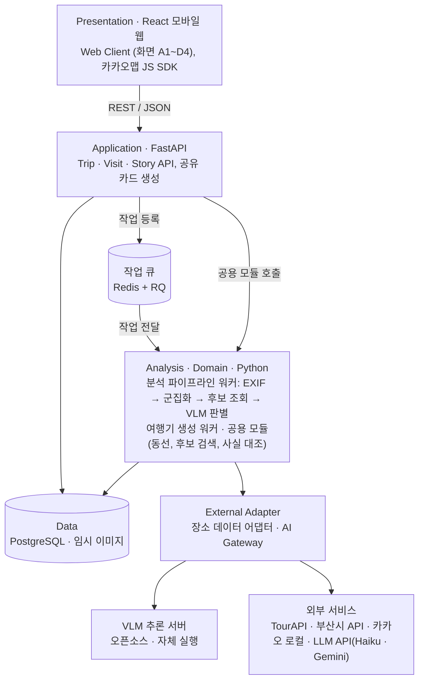
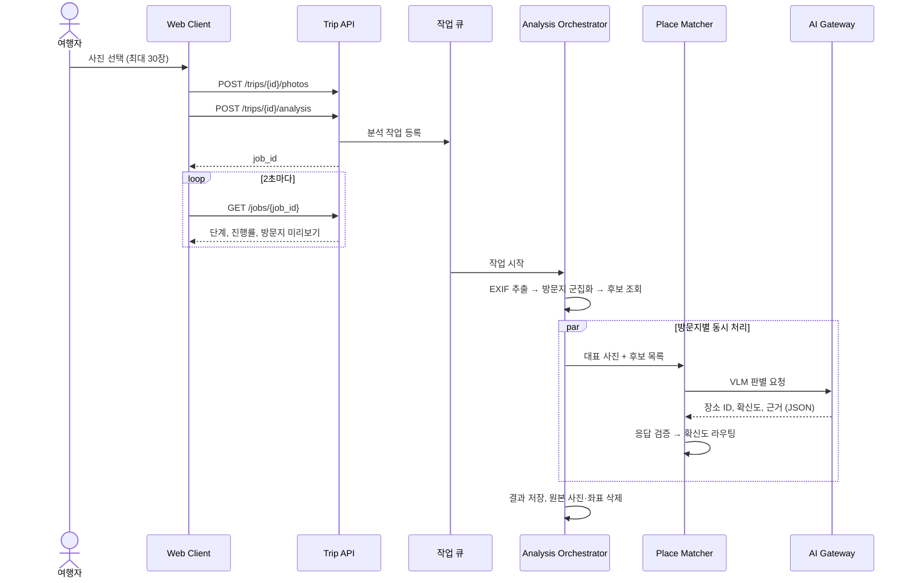
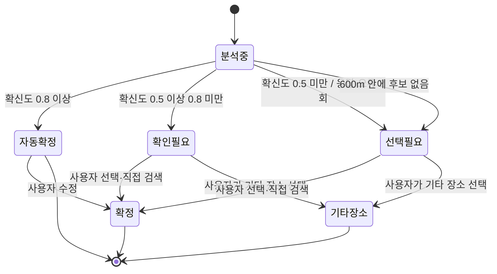
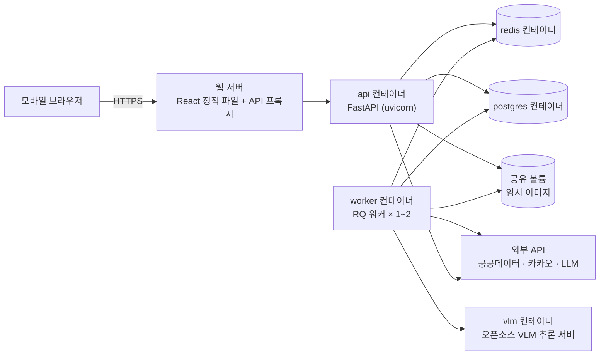

# 소프트웨어 설계서 (SDD) — 찰칵부산(가칭)

- **팀**: 2026-2 소프트웨어공학 Team 10
- **담당**: 황웅재 (아키텍처 설계), 통합 김건한
- **버전**: v1.0 · 2026-10-26 · 중간발표 제출본 (3. 컴포넌트 설계까지)
- **근거 문서**: 요구사항분석서 v1.0 ([md](../02-requirements/요구사항분석서_찰칵부산_v1.0.md))

| 버전 | 날짜 | 작성 | 변경 내용 |
|---|---|---|---|
| v0.1 | 2026-10-22 | 황웅재 | 초안 (1~3장, 컴포넌트 다이어그램) |
| v0.2 | 2026-10-25 | 김건한(PM) | 요구사항분석서 v0.2에 맞춤: FR-12 매핑, DR-09(매칭 로그) 연결, 정합성 검토 결과 반영 |
| v1.0 | 2026-10-26 | 김건한(PM) | 중간발표 제출본: 3장 컴포넌트 설계까지 10쪽 이내로 정리, 상태도 전이 추가(유스케이스 검토 R-3), 카카오맵 운영정책·부산시 데이터 후보 조회·AI 분석 동의·여행 삭제·사실 대조 방식, AI 모델 방침(오픈소스 VLM 자체 실행, 저가·무료 LLM) 반영 |

> 요구사항 ID(FR, NFR, UI, DR, AIR, AC)와 유스케이스 ID(UC-01~09)는 요구사항분석서 v1.0을 참조한다. 이 문서에서 새로 만드는 ID는 QA(품질 속성), AD(아키텍처 결정), CP(컴포넌트), IF(인터페이스)다. "PoC 후 확정"으로 표시한 값은 스프린트 1 기술 PoC에서 정한다.

---

## 1장. 개요

### 1.1 목적
이 문서는 요구사항분석서의 기능·품질 요구사항을 어떤 구조로 실현할지 정의한다. 팀원은 이 문서를 기준으로 구현 작업을 나누고, 3.4절 매핑은 요구사항분석서 10장 추적표와 같다.

### 1.2 범위
2장은 아키텍처(품질 속성, 스타일과 결정, 전체 구조, 동작 흐름, 배포), 3장은 컴포넌트 설계(책임, 인터페이스, 의존관계, 요구사항 매핑)를 다룬다. 상세 설계(클래스·DB 스키마·화면)는 최종발표용 설계서에서 다룬다.

### 1.3 설계 원칙

| 원칙 | 아키텍처에 반영한 방식 |
|---|---|
| AI는 두 곳에서만 쓴다 | VLM·LLM 호출은 AI Gateway(CP-19) 한 곳으로만 나가고, 나머지 처리는 코드 컴포넌트로 구현한다 |
| AI는 추측하지 않는다 | Place Matcher(CP-11)가 후보 목록 밖의 답을 코드로 거부한다 (closed-set) |
| 모든 사실에는 출처가 붙는다 | 공공데이터 장소는 출처·갱신일과 함께 저장하고(카카오는 실시간 조회), Fact Checker(CP-14)가 여행기 문장을 전수 검사한다 |
| 원본은 남기지 않는다 | 원본 사진은 Media Store(CP-17)에 임시로만 두고 자동 삭제하며, 사진은 서버 안 VLM에서만 처리한다 |
| 바뀔 것은 감싼다 | 외부 API와 AI 모델은 어댑터 뒤에 두어, 모델·API가 바뀌어도 안쪽 코드는 그대로 둔다 |

---

## 2장. 아키텍처 설계

### 2.1 품질 속성 시나리오

설계에 영향을 준 요인은 긴 분석 시간(수십 초), 분석 중 화면 이탈(UI-03), 많은 외부 의존성(공공데이터·카카오·LLM), 원본 비보관(NFR-04), 유료 AI 최소화, 4명·구현 4주라는 조건이다. 비기능 요구사항을 "자극 → 응답 → 측정"으로 바꾸고 설계 전술을 정했다.

| ID | 품질 속성 | 시나리오 (자극 → 응답 → 측정) | 설계 전술 | 관련 |
|---|---|---|---|---|
| QA-01 | 성능 | 사진 20장 업로드를 마치면 → 방문지 확인 화면 준비 → 60초 이내 (예상 35~45초, PoC 후 확정) | 비동기 워커, 방문지별 VLM 동시 처리, 대표 사진 1장 축소, 장소 캐시, 진행 중 결과 먼저 표시 | NFR-01, UI-01·02 |
| QA-02 | 정확도 | VLM이 후보 밖 장소·틀린 형식을 답하면 → 거부 후 1회 재요청, 실패 시 사용자 선택 → 잘못된 자동 확정 0건 | closed-set, JSON 스키마 검증, 확신도 라우팅, 매칭 로그 | NFR-02, AIR-02·03 |
| QA-03 | 신뢰성(근거) | 여행기를 생성하면 → 모든 사실 문장에 근거 장소·출처 연결 → 출처 표시율 100% | 문장별 장소 ID·필드 태깅, Fact Checker 전수 검사, 근거 없는 문장 경고·제거 | NFR-03, AIR-05·06 |
| QA-04 | 개인정보 | 분석이 끝나면(성공·실패 무관) → 원본 사진·좌표 삭제 → 서버 잔존 0건 | 임시 저장소 + 종료 시 삭제 + 주기 정리, EXIF 제거 썸네일, 서버 안 VLM, 인물 미분석 | NFR-04, DR-08, AC-09 |
| QA-05 | 변경 용이성 | VLM 모델을 바꾸면 → AI Gateway 구현 1개와 설정만 수정 → 다른 컴포넌트 수정 0건 | 어댑터, 프롬프트·임계값 설정 파일 분리, 프롬프트 버전 관리 | AIR-08 |
| QA-06 | 가용성·비용 | 외부 API가 실패·지연되면 → 2회 재시도 후 그 방문지만 사용자 선택 → 전체 작업 실패 없음 | 지수 백오프, 시간 제한, 부분 실패 허용, 캐시로 쿼터 절약 | NFR-08 |
| QA-07 | 보안 | 저장소·클라이언트 코드를 검사하면 → 서버 API 키가 없다 → 노출 0건 | 키는 서버 환경변수에만, 외부 호출은 서버 경유, 업로드 형식·크기 검증 | NFR-07 |
| QA-08 | 테스트 용이성 | 파이프라인을 테스트하면 → 외부 API 없이 같은 결과 재현 | 순수 함수 분리, 어댑터에 가짜·녹화 응답 주입 | AIR-08 |

### 2.2 아키텍처 스타일과 결정

| 후보 | 장점 | 단점 | 판단 |
|---|---|---|---|
| A. 단일 서버·동기 처리 | 가장 단순 | 분석 중 요청이 수십 초 묶이고, 화면 이탈 시 작업 유실(UI-03 불가) | 제외 |
| **B. 계층형 + 비동기 작업 큐 (파이프라인 워커)** | 긴 작업 분리, 진행률 조회, 계층별 역할 분담이 팀 구성과 맞음 | 큐·워커 운영 요소 추가 | **채택** |
| C. 마이크로서비스 | 독립 배포·확장 | 4명·4주에 운영 부담 과다, 서비스 간 통신 복잡 | 제외 |

| ID | 결정 | 이유 | 관련 |
|---|---|---|---|
| AD-01 | 전체 구조는 **계층형**(Presentation → Application → Analysis/Domain → Data, External) | 계층별로 담당(프론트, 백엔드, AI 파이프라인)을 나누기 쉽고 변경 영향이 제한된다 | 2.3 운영 환경 |
| AD-02 | 사진 분석·여행기 생성은 **작업 큐 + 워커**로 비동기 처리 | 처리 시간이 길고, 화면을 떠나도 계속되어야 한다 | NFR-01, UI-03 |
| AD-03 | 분석 워커는 **파이프라인**(EXIF → 군집화 → 후보 조회 → VLM 판별) | 단계별 입출력이 명확해 테스트가 쉽고 진행률을 보여 줄 수 있다 | UI-01 |
| AD-04 | 외부 API·AI 모델은 **어댑터**(CP-18, CP-19) 뒤에 둔다 | 모델 미정, API 변경, 테스트용 가짜 응답 주입 | QA-05·08 |
| AD-05 | 여행기 생성은 분석과 **별도 작업**으로 둔다 | 장소 확정과 문체 선택 뒤에 써야 한다 (D1 → D2) | FR-09 |
| AD-06 | 진행 상태는 클라이언트가 **주기적으로 조회(polling)** | 단순하고 모바일 웹에서 안정적이다. 실시간 푸시는 MVP에서 제외 | UI-01~03 |
| AD-07 | 회원 기능 없이 **익명 기기 토큰**으로 여행을 구분한다 | 회원 기능은 범위 밖이지만 "내 여행"은 필요하다 | 1.2 범위 |
| AD-08 | VLM은 **오픈소스 모델을 별도 컨테이너에서 직접 실행**, LLM은 외부 저가·무료 API | 유료 AI 비용 최소화, 사진이 외부 AI로 나가지 않는다. 속도·정확도가 부족하면 AI Gateway로 상용 API 교체 | NFR-04·08 |

### 2.3 전체 구조

컴포넌트 단위의 연결은 3.3절 컴포넌트 다이어그램에 있다.

| 계층 | 역할 | 의존 방향 |
|---|---|---|
| Presentation | 화면 15개(A1~D4), 카카오맵 표시, 진행률 조회 | Application만 호출 |
| Application | REST API, 요청 검증, 작업 등록, 짧은 동기 처리(사용자 확정, 공유 카드) | Analysis · Domain, Data |
| Analysis · Domain | 워커의 긴 처리(사진 분석, 여행기 생성)와 API·워커 공용 모듈(동선, 후보 검색, 사실 대조) | Data, External |
| Data | 영속 데이터, 장소 캐시, 임시 이미지 | — |
| External Adapter | 외부 API·AI 모델 호출, 응답 형식 통일, 재시도 | 외부 서비스, VLM 추론 서버 |

### 2.4 주요 동작 흐름

**(1) 사진 분석 (UC-01, UC-02)** — 사진 업로드 뒤 작업 큐로 넘기고, 클라이언트는 진행 상태를 주기적으로 조회한다.

**(2) 방문지 상태 변화** — 상태 값은 요구사항분석서 DR-02와 같다.

### 2.5 배포 구조

- 개발·시연 환경은 Docker Compose 하나로 모든 컨테이너를 띄우고, API 키는 `.env`(저장소에 올리지 않음)로 주입한다.
- VLM은 vlm 컨테이너에서 직접 실행해 사진이 외부 AI로 나가지 않는다. GPU가 없으면 작은 모델을 쓰고 응답 시간은 PoC에서 확인한다(NFR-01).

| 영역 | 기술 (안) | 선택 이유 |
|---|---|---|
| 프론트엔드 | React, Vite, 카카오맵 JS SDK | 설치 없는 모바일 웹 (NFR-06), 동선 표시 (FR-07) |
| 백엔드·작업 큐 | FastAPI, RQ + Redis | 분석 코드와 언어 통일, 워커 분리 (AD-02) |
| 분석 | Pillow·pillow-heif, scikit-learn(DBSCAN), httpx | HEIC 입력 (FR-01), 군집화 (FR-02), 외부 동시 호출 |
| 데이터 | PostgreSQL | 엔티티 7개(DR-01~06, DR-09), 장소 캐시 |
| AI | VLM: 오픈소스 멀티모달 모델(예: Ollama로 실행), LLM: Claude Haiku 또는 Gemini 무료 플랜 | 비용 최소화, 사진 외부 미전송 (NFR-04). 모델은 PoC 후 확정 |
| 품질·배포 | pytest, GitHub Actions, Docker Compose | PR마다 CI, 팀원 환경과 시연 환경 통일 |

---

## 3장. 컴포넌트 설계

### 3.1 컴포넌트 명세

컴포넌트 19개를 계층별로 나누고 책임과 제공·요구 인터페이스(IF)를 정했다. 공용 모듈(CP-05, CP-10, CP-14)은 API와 워커가 같은 코드를 라이브러리로 쓴다.

| ID | 컴포넌트 | 계층 | 책임 | 제공 / 요구 인터페이스 |
|---|---|---|---|---|
| CP-01 | Web Client | Presentation | 화면 A1~D4, 사진 선택(30장 제한), AI 분석 동의, 진행률 조회(2초)·재접속 시 상태 표시, 카카오맵 동선, 익명 기기 토큰 보관 | 사용자 화면 / IF-02~04, 카카오맵 JS SDK |
| CP-02 | Trip API | Application | 여행 생성·삭제, 사진 업로드(형식·개수·크기 검증), 동의 확인 후 분석 작업 등록, 작업 상태 조회 | IF-02 / IF-15, IF-17, 작업 큐 |
| CP-03 | Visit API | Application | 방문지·후보·AI 근거 조회, 장소 확정·변경·기타 장소, 직접 검색, 위치 없는 사진 배정, 장소 상세(카카오는 실시간 조회), 동선 조회 | IF-03 / IF-05, IF-10, IF-15, IF-16, IF-18 |
| CP-04 | Story API | Application | 여행기 생성·다시 쓰기 작업 등록, 편집 저장과 사실 대조 경고, 공유 카드 요청 | IF-04 / 작업 큐, IF-06, IF-14, IF-15 |
| CP-05 | Route Service | Domain (공용 모듈) | 날짜별 동선, 이동 시간(직선 거리 × 보정 계수, PoC 후 확정), 타임라인 계산. 기타 장소는 방문지 중심 좌표 사용 | IF-05 / IF-15 |
| CP-06 | Share Card Renderer | Application | 썸네일·제목·동선 요약으로 공유 이미지 생성 (좌표·EXIF 제외) | IF-06 / IF-15, IF-17 |
| CP-07 | Analysis Orchestrator | Analysis | EXIF → 군집화 → 후보 → VLM 순서 실행, 진행률 기록, 방문지 단위 실패 격리, 종료 시 원본·좌표 삭제 | IF-07 / IF-08~12, IF-15, IF-17 |
| CP-08 | EXIF Extractor | Analysis | 촬영 시각·GPS 추출, VLM용 축소본과 EXIF 제거 썸네일 생성 | IF-08 / 없음 (순수 로직) |
| CP-09 | Visit Clusterer | Analysis | DBSCAN으로 방문지 묶기, 중심 좌표·시각·순서·대표 사진, 날짜 분리. 위치 없으면 촬영 시각으로 분리 | IF-09 / 없음 (순수 로직) |
| CP-10 | Candidate Finder | Domain (공용 모듈) | 반경 300m→600m 후보 조회(TourAPI, 장소 캐시의 부산시 데이터, 카카오 보조), 중복 합치기, 거리순 2~3곳, 키워드 검색 | IF-10 / IF-16, IF-18 |
| CP-11 | Place Matcher | Analysis | VLM 판별 요청, 후보 안 답인지 검증·1회 재요청, 확신도 라우팅, 매칭 로그 기록 | IF-11 / IF-15, IF-19 |
| CP-12 | Untagged Photo Resolver | Analysis | 위치 없는 사진의 방문지 추천 (시간 보간, 애매하면 VLM 비교) | IF-12 / IF-19 |
| CP-13 | Story Generator | Analysis | 확정 사실만으로 LLM 여행기 생성, 문장별 장소 ID·필드 수신, 각주 생성, AI 작성 표시, 문단 다시 쓰기 | IF-13 / IF-05, IF-14, IF-15, IF-16, IF-19 |
| CP-14 | Fact Checker | Domain (공용 모듈) | 문장의 장소 ID·필드 값을 공식 데이터와 대조 (편집 문장은 장소명·수치만) | IF-14 / 없음 (순수 로직) |
| CP-15 | Trip Repository | Data | 여행·방문지·사진·여행기·각주·매칭 로그 저장, 여행 삭제 시 연쇄 삭제 | IF-15 / PostgreSQL |
| CP-16 | Place Cache | Data | 공공데이터 장소를 (출처, 원본 ID)로 저장하고 출처·갱신일 보관. 카카오 결과는 캐시하지 않음 | IF-16 / PostgreSQL |
| CP-17 | Media Store | Data | 원본 사진 임시 저장과 자동 삭제(작업 종료·주기 정리), 썸네일 보관 | IF-17 / 공유 볼륨 |
| CP-18 | Place Data Adapter | External | TourAPI·부산시·카카오 로컬을 공통 형식으로 감싸기, 시간 제한·2회 재시도·호출 수 기록, 부산시 목록 일 1회 적재 | IF-18 / 외부 API |
| CP-19 | AI Gateway | External | VLM(서버 안 오픈소스 모델)·LLM(외부 API) 호출, 프롬프트 버전 관리, JSON 스키마 강제, 인물 미분석 지시. 사진은 VLM에만 전달 | IF-19 / VLM 추론 서버, LLM API |

### 3.2 외부 인터페이스 (REST API 초안)

모든 경로는 `/api/v1` 아래에 두고, 요청 헤더의 익명 기기 토큰으로 여행 소유자를 구분한다 (AD-07).

| IF | 주요 엔드포인트 | 컴포넌트 | 관련 |
|---|---|---|---|
| IF-02 Trip | `POST·GET /trips`, `DELETE /trips/{id}`(연쇄 삭제), `POST /trips/{id}/photos`(최대 30장), `POST /trips/{id}/analysis`(AI 분석 동의 필요 → job_id), `GET /jobs/{id}`(단계·진행률·미리보기) | CP-02 | FR-01~04, NFR-04, UI-01~03 |
| IF-03 Visit | `GET /trips/{id}/visits`, `GET /visits/{id}/candidates`, `PUT /visits/{id}/place`, `GET /places/search`, `PUT /photos/{id}/visit`(위치 없는 사진), `GET /trips/{id}/route?day=`, `GET /places/{id}` | CP-03 | FR-05~08, FR-12 |
| IF-04 Story | `POST /trips/{id}/stories`(→ job_id), `GET·PATCH /stories/{id}`(편집 → 사실 대조 경고), `POST /stories/{id}/paragraphs/{pid}/rewrite`, `POST /stories/{id}/share-card` | CP-04 | FR-09~11 |

VLM 판별 응답은 `{"place_id": "tour:126508 | none", "confidence": 0.86, "reason": "..."}` 형식만 허용하고, 후보 밖 ID는 CP-11이 거부한다 (AIR-02·03).

### 3.3 의존관계와 컴포넌트 다이어그램

> UML 표기(제공 인터페이스 ○, 사용 의존 점선 화살표)로 그린 컴포넌트 다이어그램은 Visual Paradigm VPasCode로 렌더링했다. 원본 코드: [component-diagram.puml](component-diagram.puml)

의존 규칙:

1. 위 계층만 아래 계층을 호출한다. Data·External 계층은 위 계층을 모른다.
2. Application과 Analysis 사이의 오래 걸리는 호출은 작업 큐를 거친다.
3. 서버 쪽 외부 호출은 CP-18, CP-19를 거쳐서만 한다. 예외로 브라우저의 지도 표시는 CP-01이 카카오맵 JS SDK를 직접 쓴다 (NFR-07).
4. 순수 로직(CP-08, CP-09, CP-14)은 다른 컴포넌트에 의존하지 않는다 → 단위 테스트 대상.
5. 컴포넌트는 하나의 책임 묶음(유스케이스 또는 처리 단계)으로 나눠 응집도를 높이고, 정의된 인터페이스로 필요한 데이터만 주고받아 결합도를 낮춘다.

### 3.4 요구사항 ↔ 컴포넌트 매핑

| FR | 요구사항 | UC | 주 컴포넌트 | 협력 컴포넌트 |
|---|---|---|---|---|
| FR-01 | 사진 업로드·EXIF 추출 | UC-01 | CP-08 | CP-01, CP-02, CP-07, CP-17 |
| FR-02 | 방문지 군집화 | UC-01 | CP-09 | CP-07 |
| FR-03 | 공식 데이터 후보 조회 | UC-02 | CP-10 | CP-07, CP-16, CP-18 |
| FR-04 | VLM 판별·확신도 | UC-02 | CP-11 | CP-07, CP-19 |
| FR-05 | 사용자 확인·수정 | UC-02 | CP-03 | CP-01, CP-10, CP-15 |
| FR-06 | 위치 없는 사진 처리 | UC-03 | CP-12 | CP-03, CP-07, CP-19 |
| FR-07 | 지도 동선·타임라인 | UC-04 | CP-05 | CP-01, CP-03 |
| FR-08 | 장소 상세 | UC-05 | CP-03 | CP-16, CP-18 |
| FR-09 | 근거 기반 여행기 | UC-06, UC-09 | CP-13 | CP-04, CP-14, CP-19 |
| FR-10 | 문단 다시 쓰기·사실 대조 | UC-07, UC-09 | CP-14 | CP-04, CP-13 |
| FR-11 | 공유 카드 | UC-08 | CP-06 | CP-04, CP-17 |
| FR-12 | 근처 못 가본 곳 추천 | UC-04 | CP-10 | CP-03, CP-05 |

비기능 요구사항의 전술은 2.1절, 담당 컴포넌트는 요구사항분석서 10장에 있다.

*AI 활용 명기: 이 설계서는 Claude Code(Anthropic)의 도움을 받아 작성함 — 요구사항분석서 정합성 검토, 아키텍처·컴포넌트 구성안, 다이어그램 초안, 문서 통합. 팀 검토 후 확정한다.*
