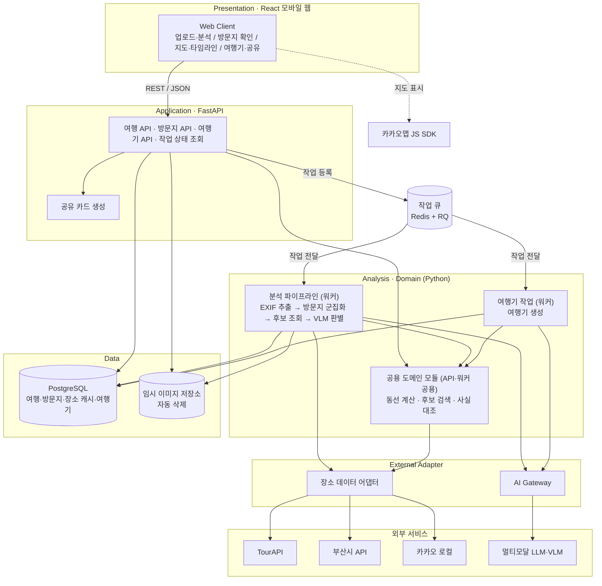
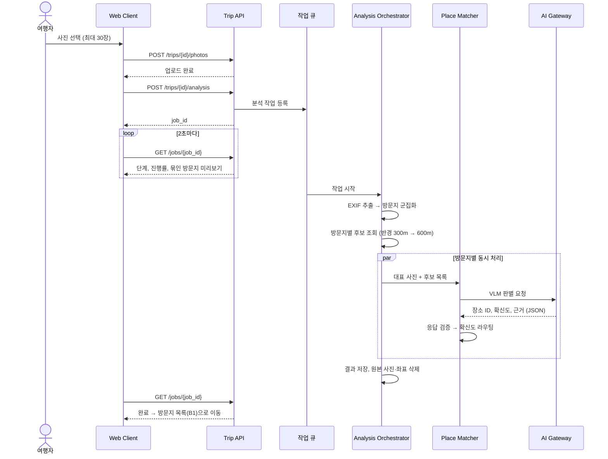
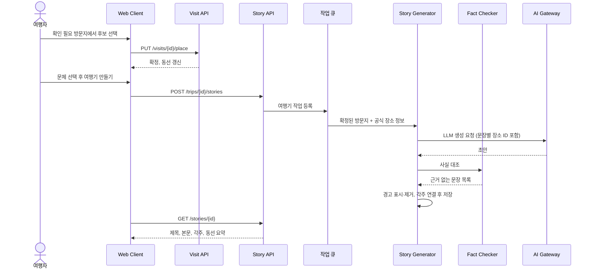
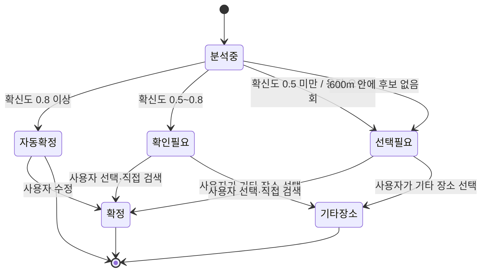
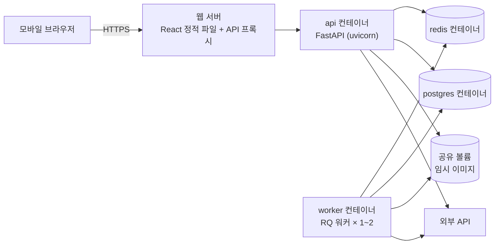
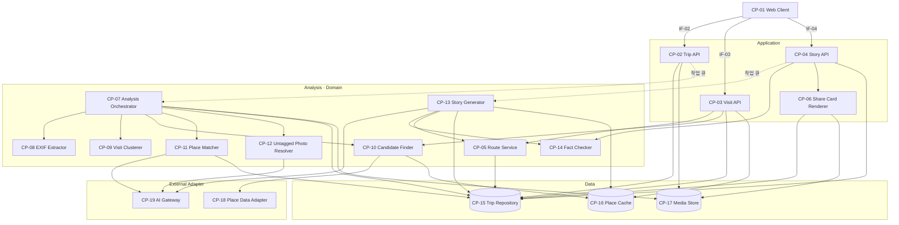

# 설계서 (SDD) — 찰칵부산(가칭)

- **팀**: 2026-2 소프트웨어공학 Team 10
- **담당**: 황웅재 (아키텍처 설계)
- **작성 범위**: 1장 개요, 2장 아키텍처 설계, 3장 컴포넌트 설계 (중간발표 필수 범위)
- **버전**: v1.0 · 2026-10-26 · 중간발표 제출본
- **근거 문서**: 요구사항분석서 v1.0 (2026-10-26, 5장 유스케이스·10장 추적표 포함)

| 버전 | 날짜 | 작성 | 변경 내용 |
|---|---|---|---|
| v0.1 | 2026-10-22 | 황웅재 | 초안 (1~3장, 컴포넌트 다이어그램) |
| v0.2 | 2026-10-25 | 김건한(PM) | 요구사항분석서 v0.2에 맞춤: 근거 문서 갱신, FR-12 매핑 추가, DR-09(매칭 로그) 연결, 부록 B 반영 결과 표시 |
| v1.0 | 2026-10-26 | 김건한(PM) | 중간발표 제출본: 유스케이스 검토 의견 R-3 반영(상태도에 확인필요 → 기타장소 전이 추가), 근거 문서를 요구사항분석서 v1.0으로 갱신 |

> 요구사항 ID(FR, NFR, UI, DR, AIR, AC)와 유스케이스 ID(UC-01~09)는 요구사항분석서 v1.0을 그대로 참조합니다.
> 이 문서에서 새로 만드는 ID는 **QA**(품질 속성 시나리오), **AD**(아키텍처 결정), **CP**(컴포넌트), **IF**(인터페이스)입니다.
> "PoC 후 확정"으로 표시한 값은 스프린트 1 기술 PoC 결과로 확정한다 (부록 A 미결 사항).

---

## 1장. 개요

### 1.1 목적
이 문서는 요구사항분석서에 정의된 찰칵부산의 기능·품질 요구사항을 어떤 구조로 실현할지 정의한다. 팀원은 이 문서를 기준으로 구현 작업을 나누고, 유스케이스 담당은 3.5절 매핑표로 요구사항 추적표(FR ↔ UC ↔ 컴포넌트)를 완성한다.

### 1.2 범위
- 2장: 아키텍처 스타일과 선정 근거, 품질 속성 시나리오, 전체 구조, 주요 동작 흐름, 배포 구조, 기술 스택
- 3장: 컴포넌트 식별, 책임, 제공·요구 인터페이스, 의존관계, 컴포넌트 다이어그램, 요구사항 매핑
- 상세 설계(클래스·DB 스키마·화면 상세)는 최종발표용 설계서에서 다룬다.

### 1.3 설계 원칙
요구사항분석서의 제약(2.5)과 AI 역할 범위(8.1), 비기능 요구사항을 아키텍처 수준으로 옮긴 것이다.

| 원칙 | 아키텍처에 반영한 방식 |
|---|---|
| AI는 두 곳에서만 쓴다 | VLM·LLM 호출은 AI Gateway(CP-19) 한 곳으로만 나간다. 나머지 처리는 모두 코드 컴포넌트로 구현한다 |
| AI는 추측하지 않는다 | Place Matcher(CP-11)가 후보 목록 밖의 답을 코드로 거부한다 (closed-set) |
| 모든 사실에는 출처가 붙는다 | 장소 정보는 출처·갱신일과 함께 저장하고, Fact Checker(CP-14)가 여행기 문장을 전수 검사한다 |
| 원본은 남기지 않는다 | 원본 사진은 Media Store(CP-17)에 임시로만 두고 자동 삭제한다 |
| 바뀔 것은 감싼다 | 외부 API와 AI 모델은 어댑터 뒤에 두어, 모델·API가 바뀌어도 안쪽 코드는 그대로 둔다 |

---

## 2장. 아키텍처 설계

### 2.1 설계에 영향을 주는 요인

| 요인 | 내용 | 설계에 주는 영향 |
|---|---|---|
| 처리 시간이 긴 분석 | 사진 20장 분석에 외부 API·VLM 호출이 여러 번 필요 (수십 초) | HTTP 요청 안에서 처리할 수 없음 → 비동기 처리 필요 |
| 사용자가 화면을 떠남 | 분석 중 화면을 떠나도 계속되어야 함 (UI-03) | 작업 상태를 서버에 저장하고 나중에 조회 |
| 외부 의존성이 많음 | TourAPI, 부산시 API, 카카오, LLM·VLM — 쿼터·장애·모델 미정 | 어댑터로 격리, 캐시, 재시도 |
| VLM 모델 미정 | PoC 후 결정 | AI 호출부를 교체 가능하게 설계 |
| 개인정보 | 원본 사진·좌표 보관 금지 (NFR-04, DR-08) | 임시 저장소와 자동 삭제를 구조에 포함 |
| 팀 규모·기간 | 4명, 구현 4주 (스프린트 2회) | 운영 복잡도가 낮은 구조 선택 |

### 2.2 품질 속성 시나리오

요구사항분석서 4장의 비기능 요구사항을 "자극 → 응답 → 측정" 형태로 바꾸고, 각각을 달성할 설계 전술을 정했다.

| ID | 품질 속성 | 시나리오 (자극 → 응답 → 측정) | 설계 전술 | 관련 |
|---|---|---|---|---|
| QA-01 | 성능 | 사용자가 사진 20장 업로드를 마치면 → 방문지 확인 화면이 준비된다 → 60초 이내 | 비동기 워커, 방문지별 VLM 동시 호출, 대표 사진 1장만 축소 전송, 장소 캐시, 진행 중 결과 먼저 표시 | NFR-01, UI-01·02 |
| QA-02 | 정확도 | VLM이 후보 밖 장소나 틀린 형식을 답하면 → 코드가 거부하고 1회 재요청, 다시 실패하면 사용자 선택으로 넘긴다 → 잘못된 장소가 자동 확정되는 경우 0건 | closed-set 매칭, JSON 스키마 검증, 확신도 라우팅, 매칭 로그 저장 | NFR-02, AIR-02·03 |
| QA-03 | 신뢰성(근거) | LLM이 여행기를 생성하면 → 모든 사실 문장에 근거 장소와 출처가 연결된다 → 출처 표시율 100% | 문장 단위 장소 ID 태깅, Fact Checker 전수 검사, 근거 없는 문장 경고·제거 | NFR-03, AIR-05·06 |
| QA-04 | 개인정보 | 분석 작업이 끝나면(성공·실패 무관) → 원본 사진과 사진 좌표가 삭제된다 → 서버 저장소 잔존 0건 | 임시 저장소 + 작업 종료 시 삭제 + 주기적 정리, 표시용 썸네일은 EXIF 제거, 인물 미분석 프롬프트 | NFR-04, DR-08, AC-09 |
| QA-05 | 변경 용이성 | VLM 모델을 교체하면 → AI Gateway의 구현 1개와 설정만 바꾼다 → 다른 컴포넌트 수정 0건 | 어댑터 패턴, 프롬프트·임계값을 설정 파일로 분리, 프롬프트 버전 관리 | AIR-08, 2.6 가정 |
| QA-06 | 가용성·비용 | 외부 API가 실패하거나 느리면 → 2회 재시도 후, 해당 방문지만 사용자 선택으로 넘기고 나머지는 진행한다 → 전체 작업 실패 없음 | 지수 백오프 재시도, 시간 제한, 부분 실패 허용, 장소 캐시로 쿼터 절약 | NFR-08 |
| QA-07 | 보안 | 저장소와 클라이언트 코드를 검사하면 → 서버 API 키가 발견되지 않는다 → 노출 0건 | 키는 서버 환경변수에만, 외부 호출은 모두 서버 경유, 업로드 형식·크기 검증 | NFR-07 |
| QA-08 | 테스트 용이성 | 개발자가 파이프라인을 테스트하면 → 외부 API 없이 같은 결과가 재현된다 | 코드 로직을 순수 함수로 분리, 어댑터에 가짜(mock)·녹화 응답 주입 | 8.1, AIR-08 |

**QA-01 성능 예산 (추정, PoC 후 확정)**

| 단계 | 예상 시간 | 근거 |
|---|---|---|
| EXIF 추출 + 군집화 | 5초 이내 | 로컬 계산 |
| 후보 조회 (방문지 6곳) | 5초 이내 | 방문지별 동시 호출, 캐시 적중 시 거의 0 |
| VLM 판별 (방문지 6곳) | 20~30초 | 동시 3~4개 호출, 1회 약 10초 가정 |
| 저장·동선 계산 | 5초 이내 | 로컬 계산 |
| **합계** | **약 35~45초** | 목표 60초 대비 여유 15초 이상 |

### 2.3 아키텍처 스타일 선정

**후보 비교**

| 후보 | 장점 | 단점 | 판단 |
|---|---|---|---|
| A. 단일 서버, 동기 처리 | 가장 단순 | 분석 중 HTTP 요청이 수십 초 묶임, 화면 이탈 시 작업 유실 (UI-03 불가), 타임아웃 위험 | 제외 |
| **B. 계층형 + 비동기 작업 큐 (파이프라인 워커)** | 긴 작업을 분리, 진행률 조회 가능, 계층별 역할 분담이 팀 구성과 맞음 | 큐·워커 운영 요소 추가 | **채택** |
| C. 마이크로서비스 | 독립 배포·확장 | 4명·4주에 비해 운영 부담 과다, 서비스 간 통신 복잡 | 제외 |

**아키텍처 결정**

| ID | 결정 | 이유 | 관련 |
|---|---|---|---|
| AD-01 | 전체 구조는 **계층형**(Presentation → Application → Analysis/Domain → Data, External)으로 한다 | 계층마다 담당을 나누기 쉽고(프론트, 백엔드, AI 파이프라인), 위 계층만 아래 계층에 의존해 변경 영향이 제한된다 | 2.4 운영 환경 |
| AD-02 | 사진 분석과 여행기 생성은 **작업 큐 + 워커**에서 비동기로 처리한다 | 처리 시간이 길고, 사용자가 화면을 떠나도 계속되어야 한다 | NFR-01, UI-03 |
| AD-03 | 분석 워커 내부는 **파이프라인**(EXIF → 군집화 → 후보 조회 → VLM 판별)으로 구성한다 | 단계마다 입출력이 명확해 단위 테스트가 쉽고, 단계별 진행률을 화면에 보여 줄 수 있다 | UI-01, 2.2 제품 기능 요약 |
| AD-04 | 외부 API와 AI 모델은 **어댑터**(Place Data Adapter, AI Gateway) 뒤에 둔다 | 모델 미정, API 쿼터·형식 변경, 테스트 시 가짜 응답 주입 | QA-05·08 |
| AD-05 | 여행기 생성은 사진 분석과 **별도 작업**으로 둔다 | 여행기는 사용자가 장소를 확정하고 문체를 고른 뒤에 만든다 (D1 → D2). 분석 파이프라인 마지막 단계에 붙이면 확정 전 데이터로 글을 쓰게 된다 | FR-09 |
| AD-06 | 분석 진행 상태는 클라이언트가 **주기적으로 조회(polling)**한다 | 구현이 단순하고 모바일 웹에서 안정적이다. 실시간 푸시는 MVP에서 제외 | UI-01~03 |
| AD-07 | 회원 기능 없이 **익명 기기 토큰**으로 사용자의 여행을 구분한다 | 회원 기능은 범위 밖이지만 "내 여행" 목록은 있어야 한다 | 1.2 범위, 6.1 하단 탭 |

### 2.4 전체 구조



| 계층 | 역할 | 의존 방향 |
|---|---|---|
| Presentation | 화면 15개(A1~D4), 카카오맵 표시, 진행률 조회 | Application만 호출 |
| Application | REST API, 요청 검증, 작업 등록, 짧은 동기 처리(사용자 확정, 공유 카드) | Analysis · Domain, Data |
| Analysis · Domain | 워커에서 도는 오래 걸리는 처리(사진 분석, 여행기 생성)와, API·워커가 함께 쓰는 도메인 모듈(동선 계산, 후보 검색, 사실 대조) | Data, External |
| Data | 영속 데이터, 장소 캐시, 임시 이미지 | — |
| External Adapter | 외부 API·AI 모델 호출, 응답 형식 통일, 재시도 | 외부 서비스 |

### 2.5 주요 동작 흐름

#### (1) 사진 분석 (UC-01, UC-02 일부)



#### (2) 사용자 확인 → 여행기 생성 (UC-02, UC-06)



#### (3) 방문지 상태 변화



> 위 상태 값은 요구사항분석서 v0.2의 DR-02 status(분석중/자동확정/확인필요/선택필요/확정/기타장소)와 같다. "확인필요", "선택필요"는 화면(B1·B2) 표시를 위한 중간 상태이다.

### 2.6 배포 구조



- 개발·시연 환경은 Docker Compose 하나로 모든 컨테이너를 띄운다.
- API 키는 `.env`(저장소에 올리지 않음)로 주입하고, 저장소에는 `.env.example`만 둔다.

### 2.7 기술 스택 (안)

| 영역 | 기술 | 선택 이유 |
|---|---|---|
| 프론트엔드 | React, Vite, 카카오맵 JS SDK | 모바일 웹, 설치 불필요 (NFR-06), 카카오맵 동선 표시 (FR-07) |
| 백엔드 API | FastAPI | Python으로 분석 코드와 언어 통일, 자동 API 문서 |
| 작업 큐 | RQ + Redis | 분석 워커와 API 서버 분리 (2.4). Celery보다 설정이 단순 |
| 이미지·EXIF | Pillow, pillow-heif | HEIC 입력 지원 (FR-01) |
| 군집화 | scikit-learn (DBSCAN) | FR-02 |
| 외부 호출 | httpx | 비동기 동시 호출, 시간 제한 설정 |
| 데이터 | PostgreSQL | 관계형 엔티티 6개(DR-01~06), 장소 캐시 |
| AI | 멀티모달 LLM API (모델은 PoC 후 결정) | VLM 판별 + LLM 여행기를 같은 공급자로 처리 가능 (PoC 후 확정, 부록 A-1) |
| 품질 | pytest, GitHub Actions | 단위·통합 테스트, PR마다 CI |
| 배포 | Docker Compose | 팀원 로컬 환경과 시연 환경을 같게 유지 |

---

## 3장. 컴포넌트 설계

### 3.1 컴포넌트 목록

| ID | 컴포넌트 | 계층 | 한 줄 책임 |
|---|---|---|---|
| CP-01 | Web Client | Presentation | 화면 A1~D4, 업로드, 진행률 표시, 지도 표시 |
| CP-02 | Trip API | Application | 여행 생성, 사진 업로드, 분석 작업 등록, 작업 상태 조회 |
| CP-03 | Visit API | Application | 방문지·후보 조회, 장소 확정·수정, 직접 검색, 위치 없는 사진 배정, 장소 상세 |
| CP-04 | Story API | Application | 여행기 생성 요청·조회·편집, 문단 다시 쓰기, 공유 카드 요청 |
| CP-05 | Route Service | Domain (공용 모듈) | 동선, 방문지 간 이동 시간, 날짜별 타임라인 계산 |
| CP-06 | Share Card Renderer | Application | 좌표가 없는 공유 카드 이미지 생성 |
| CP-07 | Analysis Orchestrator | Analysis | 분석 파이프라인 단계 실행, 진행률 기록, 부분 실패 처리, 원본 삭제 |
| CP-08 | EXIF Extractor | Analysis | 촬영 시각·GPS 추출, 대표 사진·썸네일 생성 |
| CP-09 | Visit Clusterer | Analysis | 시간·거리 기준 방문지 군집화, 날짜 분리 |
| CP-10 | Candidate Finder | Domain (공용 모듈) | 방문지 반경 내 공식 데이터 후보 조회, 반경 확대, 키워드 검색 |
| CP-11 | Place Matcher | Analysis | VLM 판별 요청, 응답 검증·재요청, 확신도 라우팅, 매칭 로그 |
| CP-12 | Untagged Photo Resolver | Analysis | 위치 없는 사진의 방문지 추천 (시간 보간, VLM 비교) |
| CP-13 | Story Generator | Analysis | 확정 사실만으로 여행기 생성, 문장별 장소 연결, 각주 생성 |
| CP-14 | Fact Checker | Domain (공용 모듈) | 여행기·편집 문장의 사실을 공식 데이터와 대조 |
| CP-15 | Trip Repository | Data | 여행·방문지·사진·여행기·각주·매칭 로그 저장 (PostgreSQL) |
| CP-16 | Place Cache | Data | 외부 장소 데이터 캐시, 출처·갱신일 보관 |
| CP-17 | Media Store | Data | 원본 사진 임시 저장과 자동 삭제, 썸네일 보관 |
| CP-18 | Place Data Adapter | External | TourAPI·부산시 API·카카오 로컬 호출과 응답 형식 통일 |
| CP-19 | AI Gateway | External | VLM·LLM 호출, 프롬프트 버전 관리, 응답 스키마 강제, 재시도 |

> 공용 모듈(CP-05, CP-10, CP-14)은 논리적으로 각각 하나의 컴포넌트이지만, API와 워커 양쪽에서 같은 코드를 라이브러리로 불러 쓴다 (동선 조회, FR-05 직접 검색, FR-10 편집 대조). 이렇게 Domain 계층에 두어야 워커의 Story Generator가 위 계층(Application)을 호출하지 않는다.

### 3.2 컴포넌트 명세

형식: **책임** / **제공 인터페이스** / **요구 인터페이스** / **관련 요구사항**

#### CP-01 Web Client
- **책임**: 화면 15개(A1~D4)를 표시한다. 사진을 고르고 30장 초과를 막는다. 분석 진행률을 2초마다 조회해 단계·미리보기를 보여 준다. 카카오맵으로 동선을 그린다. 익명 기기 토큰을 만들어 보관한다.
- **제공**: 사용자 화면
- **요구**: IF-02 Trip REST, IF-03 Visit REST, IF-04 Story REST, 카카오맵 JS SDK
- **관련**: UI-01~08, NFR-05·06, FR-01·05·07

#### CP-02 Trip API
- **책임**: 여행을 만들고 사진을 받는다(형식·개수·크기 검증). 원본은 Media Store에 임시 저장한다. 분석 작업을 큐에 등록하고, 작업 상태(단계, 진행률, 미리보기 방문지)를 돌려준다. 기기 토큰으로 "내 여행" 목록을 조회한다.
- **제공**: IF-02 Trip REST
- **요구**: IF-15 Trip Repository, IF-17 Media Store, 작업 큐
- **관련**: FR-01, UI-01~03, NFR-07

#### CP-03 Visit API
- **책임**: 방문지 목록과 상태를 돌려준다. 방문지별 후보·AI 추천·판단 근거를 돌려준다. 사용자의 장소 확정·변경·기타 장소 저장을 처리하고 매칭 로그에 사용자 결과를 남긴다. 직접 검색, 위치 없는 사진 배정, 장소 상세, 동선 조회를 처리한다.
- **제공**: IF-03 Visit REST
- **요구**: IF-10 Candidate Finder(검색), IF-05 Route Service, IF-15 Trip Repository, IF-16 Place Cache
- **관련**: FR-05·06·07·08, UI-04·05·06

#### CP-04 Story API
- **책임**: 여행기 생성 작업을 큐에 등록하고 결과를 돌려준다. 사용자 편집을 저장하고 Fact Checker로 경고를 돌려준다. 문단 다시 쓰기 작업을 등록한다. 공유 카드 생성을 요청한다.
- **제공**: IF-04 Story REST
- **요구**: 작업 큐, IF-14 Fact Checker, IF-06 Share Card, IF-15 Trip Repository
- **관련**: FR-09·10·11, UI-07

#### CP-05 Route Service
- **책임**: 확정된 방문지를 시간순으로 이어 날짜별 동선을 만들고, 방문지 사이 이동 시간을 계산한다. 이동 시간은 외부 길찾기 API 없이 직선 거리에 보정 계수를 곱해 추정한다 (기준값은 PoC 후 확정, 부록 A-4).
- **제공**: IF-05 `build_route(trip_id, day?) → Route{days[], legs[], timeline[]}`
- **요구**: IF-15 Trip Repository
- **관련**: FR-07, AC-06

#### CP-06 Share Card Renderer
- **책임**: 대표 썸네일, 제목, 동선 요약으로 공유 이미지를 만든다. 좌표·주소 등 정확한 위치 정보와 EXIF를 넣지 않는다.
- **제공**: IF-06 `render_card(story_id) → image`
- **요구**: IF-15 Trip Repository, IF-17 Media Store(썸네일)
- **관련**: FR-11, AC-10

#### CP-07 Analysis Orchestrator
- **책임**: 큐에서 분석 작업을 받아 EXIF → 군집화 → 후보 조회 → VLM 판별 순서로 실행한다. 단계가 끝날 때마다 진행률과 미리보기를 저장한다. 방문지 단위로 실패를 격리해 한 곳이 실패해도 나머지를 진행한다. 작업이 끝나면(성공·실패 무관) 원본 사진과 사진 좌표를 삭제한다.
- **제공**: IF-07 `run_analysis(job_id, trip_id)` (작업 큐 소비)
- **요구**: IF-08, IF-09, IF-10, IF-11, IF-12, IF-15, IF-17
- **관련**: FR-01~04·06, NFR-01·04·08, UI-01~03, DR-08

#### CP-08 EXIF Extractor
- **책임**: 사진에서 촬영 시각과 GPS를 읽는다(JPEG, HEIC, PNG). 위치·시각 유무를 판정한다. VLM 전송용 축소본과 화면 표시용 썸네일(EXIF 제거)을 만든다.
- **제공**: IF-08 `extract(image) → PhotoMeta{taken_at, has_gps, lat, lng}`, `make_derivatives(image) → {vlm_image, thumbnail}`
- **요구**: 없음 (순수 로직)
- **관련**: FR-01, AIR-07, AC-01

#### CP-09 Visit Clusterer
- **책임**: 위치가 있는 사진을 시간 차와 거리 기준(DBSCAN)으로 방문지로 묶는다. 방문지별 중심 좌표, 시작·종료 시각, 방문 순서, 대표 사진을 정한다. 날짜별로 나눈다.
- **제공**: IF-09 `cluster(photos, params) → list[VisitDraft]`
- **요구**: 없음 (순수 로직, 임계값은 설정 파일)
- **관련**: FR-02, AC-02

#### CP-10 Candidate Finder
- **책임**: 방문지 중심 반경 300m 안의 장소를 공식 데이터에서 찾고, 음식점·카페는 카카오 로컬로 보조 검색한다. 후보가 없으면 600m로 넓혀 다시 찾는다. 중복 장소를 합치고 거리순으로 2~3곳을 고른다. 결과는 Place Cache에 저장한다. 사용자 직접 검색(키워드)도 처리한다.
- **제공**: IF-10 `find(center, radius=300) → list[PlaceCandidate]`, `search(keyword, near) → list[PlaceCandidate]`
- **요구**: IF-18 Place Data Adapter, IF-16 Place Cache
- **관련**: FR-03·05, AC-03, NFR-08

#### CP-11 Place Matcher
- **책임**: 대표 사진 축소본과 후보 목록으로 VLM 판별을 요청한다. 응답의 장소 ID가 후보에 있는지, 형식이 맞는지 검증하고, 틀리면 1회 재요청한다. 확신도에 따라 자동 확정·확인 필요·선택 필요로 나눈다. AI 선택, 확신도, 근거, 프롬프트 버전을 매칭 로그로 남긴다.
- **제공**: IF-11 `match(visit, vlm_image, candidates) → MatchResult{place_id|None, confidence, reason, route}`
- **요구**: IF-19 AI Gateway, IF-15 Trip Repository(매칭 로그)
- **관련**: FR-04, AIR-01~04·07, NFR-02, AC-04·05

#### CP-12 Untagged Photo Resolver
- **책임**: 위치 없는 사진의 촬영 시각이 앞뒤 방문지 사이에 있으면 해당 방문지를 추천한다. 시각도 애매하면 Place Matcher와 같은 방식으로 인접 방문지 사진과의 비교를 VLM에 요청한다. 최종 배정은 사용자 확인으로 넘긴다.
- **제공**: IF-12 `suggest(photo, visits) → Suggestion{visit_id, reason}`
- **요구**: IF-19 AI Gateway (시각이 애매할 때만)
- **관련**: FR-06 (Should)

#### CP-13 Story Generator
- **책임**: 확정된 방문지와 Place Cache의 공식 정보만 LLM에 넣어 여행기를 만든다. 문장마다 근거 장소 ID를 받고, Fact Checker 결과로 근거 없는 문장을 경고·제거한다. 장소 이름을 장소 ID와 연결하고, 출처·갱신일로 각주를 만든다. 날짜별 동선 요약을 넣는다. 문단 다시 쓰기도 처리한다.
- **제공**: IF-13 `generate(trip_id, style) → Story`, `rewrite(story_id, paragraph_id) → Paragraph`
- **요구**: IF-19 AI Gateway, IF-14 Fact Checker, IF-05 Route Service, IF-15, IF-16
- **관련**: FR-09·10, AIR-05·06, NFR-03, AC-07

#### CP-14 Fact Checker
- **책임**: 문장에 연결된 장소 ID가 확정 방문지에 있는지 확인한다. 문장 속 사실(운영시간, 위치, 장소명 등)을 공식 데이터와 대조해 불일치·근거 없음을 표시한다.
- **제공**: IF-14 `check(sentences, facts) → list[Issue{sentence_id, type, message}]`
- **요구**: 없음 (순수 로직, 대조할 사실은 호출자가 넘김)
- **관련**: AIR-06, FR-09·10, NFR-03

#### CP-15 Trip Repository
- **책임**: Trip, Visit, Photo, Story, Footnote, 작업 상태, 매칭 로그를 저장·조회한다. 사용자가 여행을 지우면 관련 데이터를 함께 지운다.
- **제공**: IF-15 엔티티별 저장·조회 (`get_trip`, `save_visits`, `update_visit_place`, `save_story`, `log_match` 등)
- **요구**: PostgreSQL
- **관련**: DR-01·02·04·05·06·09

#### CP-16 Place Cache
- **책임**: 외부에서 받은 장소 데이터를 (출처, 원본 ID) 기준으로 저장한다. 출처명·갱신일을 함께 보관하고, 오래된 항목은 다시 조회한다.
- **제공**: IF-16 `get(source, source_id)`, `put(place)`, `nearby(lat, lng, radius)`
- **요구**: PostgreSQL
- **관련**: DR-03, NFR-08, UI-04

#### CP-17 Media Store
- **책임**: 원본 사진을 작업 단위 임시 폴더에 둔다. 작업이 끝나면 삭제하고, 남은 파일은 주기적으로 정리한다(예: 1시간 경과 시). 화면 표시용 썸네일(EXIF 제거)은 여행이 삭제될 때까지 둔다.
- **제공**: IF-17 `put_temp(job_id, file)`, `get(path)`, `purge(job_id)`, `purge_expired()`, `put_thumbnail(photo_id, image)`
- **요구**: 파일 시스템(공유 볼륨)
- **관련**: NFR-04, DR-08, AC-09

#### CP-18 Place Data Adapter
- **책임**: TourAPI(위치기반 조회, 상세), 부산시 명소·맛집 API, 카카오 로컬(카테고리·키워드 검색)을 같은 인터페이스로 감싼다. 응답을 공통 `PlaceCandidate` 형식으로 바꾸고 출처·갱신일을 붙인다. 시간 제한과 2회 재시도를 적용하고, 일일 호출 수를 기록한다.
- **제공**: IF-18 `PlaceSource.nearby(lat, lng, radius)`, `detail(source_id)`, `search(keyword, near)` (구현 3개: TourApiSource, BusanSource, KakaoLocalSource)
- **요구**: 외부 API (TourAPI, 부산시 API, 카카오 로컬)
- **관련**: DR-07, FR-03·08, NFR-08

#### CP-19 AI Gateway
- **책임**: VLM·LLM 호출을 한 곳에서 처리한다. 프롬프트를 버전 붙은 파일에서 읽고, 응답을 JSON 스키마로 강제·검증한다. 인물 미분석 지시를 공통으로 넣는다. 이미지 크기를 제한하고, 호출 횟수·비용을 기록한다. 모델 공급자는 설정으로 바꾼다.
- **제공**: IF-19 `VisionModel.choose(image, candidates, prompt_ver) → ChoiceJSON`, `TextModel.generate(prompt_id, prompt_ver, input, schema) → JSON`
- **요구**: 멀티모달 LLM API
- **관련**: AIR-01·02·04·07·08, QA-05

### 3.3 외부 인터페이스 (REST API 초안)

모든 경로는 `/api/v1` 아래에 둔다. 요청 헤더의 익명 기기 토큰으로 여행 소유자를 구분한다 (AD-07).

| IF | 메서드·경로 | 설명 | 컴포넌트 | 관련 |
|---|---|---|---|---|
| IF-02 | `POST /trips` | 여행 만들기 | CP-02 | A1 |
| | `GET /trips` | 내 여행 목록 | CP-02 | 하단 탭 |
| | `POST /trips/{trip_id}/photos` | 사진 업로드 (multipart, 최대 30장) | CP-02 | FR-01, A2 |
| | `POST /trips/{trip_id}/analysis` | 분석 시작 → `job_id` | CP-02 | FR-01~04 |
| | `GET /jobs/{job_id}` | 단계, 진행률, 남은 시간, 미리보기 방문지 | CP-02 | UI-01·02, A3 |
| IF-03 | `GET /trips/{trip_id}/visits` | 방문지 목록, 상태, 확신도 | CP-03 | B1 |
| | `GET /visits/{visit_id}/candidates` | 후보, 거리, AI 추천, 판단 근거, 출처 | CP-03 | FR-05, UI-04, B2 |
| | `PUT /visits/{visit_id}/place` | 장소 확정·변경 (`place_id` 또는 `other`) | CP-03 | FR-05, B2·B4 |
| | `GET /places/search?q=&lat=&lng=` | 직접 검색 | CP-03 | UI-05 |
| | `GET /trips/{trip_id}/photos/untagged` | 위치 없는 사진과 추천 방문지 | CP-03 | FR-06, B3 |
| | `PUT /photos/{photo_id}/visit` | 위치 없는 사진 배정 | CP-03 | FR-06 |
| | `GET /trips/{trip_id}/route?day=` | 동선, 이동 시간, 타임라인 | CP-03 → CP-05 | FR-07, C1·C2 |
| | `GET /places/{place_id}` | 장소 상세 (개요, 주소, 사진, 출처, 갱신일) | CP-03 | FR-08, C3 |
| IF-04 | `POST /trips/{trip_id}/stories` | 여행기 생성 (문체) → `job_id` | CP-04 | FR-09, D1 |
| | `GET /stories/{story_id}` | 제목, 본문, 각주, 동선 요약 | CP-04 | D2 |
| | `PATCH /stories/{story_id}` | 편집 저장 → 사실 대조 경고 | CP-04 | FR-10, D3 |
| | `POST /stories/{story_id}/paragraphs/{pid}/rewrite` | 문단 다시 쓰기 → `job_id` | CP-04 | FR-10 |
| | `POST /stories/{story_id}/share-card` | 공유 카드 이미지 생성 | CP-04 → CP-06 | FR-11, D4 |

**AI Gateway 응답 형식 (AIR-02)** — VLM 판별 결과는 아래 JSON만 허용한다.

```json
{
  "place_id": "tour:126508 | none",
  "confidence": 0.86,
  "reason": "사진 속 다리 조명 형태와 해변 위치가 후보 설명과 일치"
}
```

### 3.4 의존관계와 컴포넌트 다이어그램



**의존 규칙**
1. 위 계층만 아래 계층을 호출한다. Data·External 계층은 위 계층을 모른다.
2. Application과 Analysis 사이의 오래 걸리는 호출은 작업 큐를 거친다 (점선).
3. 외부 서비스는 CP-18, CP-19를 거쳐서만 호출한다. 다른 컴포넌트는 외부 API 주소·키를 모른다.
4. 순수 로직 컴포넌트(CP-08, CP-09, CP-14)는 다른 컴포넌트에 의존하지 않는다 → 단위 테스트 대상.

> UML 표기(제공 인터페이스 ○, 사용 의존 점선 화살표)로 그린 컴포넌트 다이어그램은 Visual Paradigm VPasCode로 렌더링했다. 원본 코드: [component-diagram.puml](component-diagram.puml), 이미지: `component-diagram.png`.

### 3.5 요구사항 ↔ 컴포넌트 매핑

유스케이스 담당의 요구사항 추적표(10장)에 그대로 쓸 수 있도록 FR 기준으로 정리했다. UC는 요구사항분석서 5장(UC-01~09)과 같다.

| FR | 요구사항 | UC | 주 컴포넌트 | 협력 컴포넌트 |
|---|---|---|---|---|
| FR-01 | 사진 업로드·EXIF 추출 | UC-01 | CP-08 | CP-01, CP-02, CP-07, CP-17 |
| FR-02 | 방문지 군집화 | UC-01 | CP-09 | CP-07 |
| FR-03 | 공식 데이터 후보 조회 | UC-02 | CP-10 | CP-16, CP-18 |
| FR-04 | VLM 판별·확신도 | UC-02 | CP-11 | CP-07, CP-19 |
| FR-05 | 사용자 확인·수정 | UC-02 | CP-03 | CP-01, CP-10, CP-15 |
| FR-06 | 위치 없는 사진 처리 | UC-03 | CP-12 | CP-03, CP-07, CP-19 |
| FR-07 | 지도 동선·타임라인 | UC-04 | CP-05 | CP-01, CP-03 |
| FR-08 | 장소 상세 | UC-05 | CP-03 | CP-16, CP-18 |
| FR-09 | 근거 기반 여행기 | UC-06, UC-09 | CP-13 | CP-04, CP-14, CP-19 |
| FR-10 | 문단 다시 쓰기·사실 대조 | UC-07, UC-09 | CP-14 | CP-04, CP-13 |
| FR-11 | 공유 카드 | UC-08 | CP-06 | CP-04, CP-17 |
| FR-12 | 근처 못 가본 곳 추천 (C, MVP 이후) | UC-04 | CP-10 | CP-03, CP-05 |

| NFR | 주 컴포넌트·전술 |
|---|---|
| NFR-01 성능 | CP-07 비동기·동시 처리, CP-16 캐시, CP-19 축소 이미지 |
| NFR-02 정확도 | CP-10 후보 제한, CP-11 검증·라우팅·매칭 로그 |
| NFR-03 출처 100% | CP-13 각주 연결, CP-14 전수 검사 |
| NFR-04 개인정보 | CP-17 임시 저장·삭제, CP-08 썸네일 EXIF 제거, CP-19 인물 미분석 |
| NFR-05 사용성 | CP-11 확신도 라우팅(확인 필요한 곳만 질문), CP-01 |
| NFR-06 이식성 | CP-01 모바일 웹 |
| NFR-07 보안 | CP-18·CP-19만 서버 키 사용, 환경변수 |
| NFR-08 비용·가용성 | CP-16 캐시, CP-18·CP-19 재시도·호출 수 기록, CP-07 부분 실패 허용 |

### 3.6 구현 담당 제안

| 역할 | 컴포넌트 |
|---|---|
| 프론트엔드 | CP-01 |
| 백엔드·데이터 | CP-02, CP-03, CP-04, CP-05, CP-06, CP-15, CP-16, CP-17, CP-18 |
| AI 파이프라인 | CP-07, CP-08, CP-09, CP-10, CP-11, CP-12, CP-13, CP-14, CP-19 |

---

## 부록 A. 미결 사항 (PoC·팀 회의에서 결정)

| 번호 | 항목 | 현재 안 | 결정 방법 |
|---|---|---|---|
| A-1 | VLM·LLM 모델 | 같은 공급자의 멀티모달 모델 하나로 둘 다 처리 | PoC: 테스트셋 30장 정확도·응답 시간·비용 |
| A-2 | 확신도 산출 방식 | VLM이 답한 확신도를 그대로 사용 | PoC: VLM 자기 보고 확신도가 실제 정답률과 맞는지 확인. 안 맞으면 후보 거리 등과 결합 |
| A-3 | 군집화 임계값 | 거리·시간 임계값 설정 파일화 | PoC: 팀 촬영 사진으로 조정 |
| A-4 | 이동 시간 계산 | 직선 거리 × 보정 계수 ÷ 평균 속도 | 팀 회의: 정확도가 부족하면 길찾기 API 추가 검토 |

## 부록 B. 요구사항분석서 정합성 검토 결과

요구사항분석서 v0.1을 기준으로 설계하면서 찾은 불일치와 빈 부분이다. 이슈 #5에서 정리해 **요구사항분석서 v0.2에 모두 반영했다** (B-8은 구현 메모라 요구사항 변경 없음).

| 번호 | 위치 | 내용 | 설계서 적용 (v0.2 반영 완료) |
|---|---|---|---|
| B-1 | FR-04 ↔ 8.3 확신도 라우팅 | 확신도 0.5 미만 처리가 서로 다르다. FR-04는 "사용자 선택", 8.3은 "반경 확대 재검색 → 없으면 사용자 선택 또는 기타 장소" | 반경 확대는 **후보가 없을 때**(FR-03), 확신도 0.5 미만은 **사용자 선택**으로 분리. 8.3 표를 이 기준으로 수정 제안 |
| B-2 | DR-08 ↔ 6.1 화면 B2·C1·D2·D4 | "원본 사진 저장 안 함"인데, 장소 확인·동선 지도·여행기·공유 카드 화면은 사용자 사진을 보여 줘야 한다 | 원본·좌표는 삭제하고, EXIF를 제거한 **썸네일만 보관**. DR-04에 thumbnail 속성 추가, DR-08 문구 보완 제안 |
| B-3 | 1.2 범위 ↔ 6.1 하단 탭 | 회원 기능은 범위 밖인데 "내 여행", "MY" 탭이 있다. 사용자를 구분할 방법이 정의되지 않았다 | 익명 기기 토큰 사용 (AD-07). Trip에 owner_token 추가, 2.4 운영 환경에 명시 제안 |
| B-4 | NFR-07 ↔ FR-07 | "API 키는 서버에만"인데, FR-07의 카카오맵은 JavaScript 키를 브라우저에 넣어야 동작한다 | 카카오 JavaScript 키는 예외로 두고, 카카오 개발자 콘솔의 도메인 제한으로 보호한다고 NFR-07에 명시 제안 |
| B-5 | FR-05 ↔ 7장 데이터 | "사용자 확정 결과를 정확도 측정 데이터로 저장"하는데 저장할 엔티티가 없다 | MatchLog(visit_id, AI 선택, 확신도, 사용자 선택, 프롬프트 버전) 추가 제안. 설계서는 CP-15에 포함 |
| B-6 | DR-02 status ↔ 6.1 화면 B1·B2 | 상태가 자동/확인/기타 3개뿐이라 "확인 필요"와 "선택 필요" 방문지를 구분할 수 없다 | 2.5 (3) 상태도 기준으로 상태 값 보완 제안 |
| B-7 | 1.2 범위(C) ↔ 3장 FR, 6.1 화면 C4 | 범위에 있는 "근처 미방문 추천", "영어 여행기"에 해당하는 FR이 없다. 화면 C4(근처 못 가본 곳)도 관련 FR이 "—"이다 | v0.2에서 근처 추천은 FR-12(C)로 추가하고 영어 여행기는 범위 밖으로 이동. FR-12는 MVP 이후 구현하며 확장 지점은 CP-10, CP-05 (3.5) |
| B-8 | FR-01 | HEIC 지원을 명시했는데, Pillow 기본 기능으로는 HEIC를 읽지 못한다 | pillow-heif 추가 (2.7) |

**일치 확인한 항목**: 반경 300m/600m 후보 조회(FR-03), 확신도 임계값 0.8/0.5(FR-04), 대표 사진 1장 축소 전송(AIR-07), AI 역할 2곳 제한(8.1), 데이터 엔티티 6개(DR-01~06), 외부 API 3종과 쿼터(DR-07), 화면 15개(6.1), 운영 환경(2.4), FR-UC 매핑(3.1).

---

*AI 활용 명기(REQ-08): 이 설계서 초안은 Claude Code의 도움을 받아 작성함 — 요구사항분석서 정합성 검토, 아키텍처·컴포넌트 구성안과 다이어그램 초안 작성. v0.2 동기화(요구사항분석서 v0.2 반영)도 Claude Code의 도움을 받음. 팀 검토 후 확정한다.*
